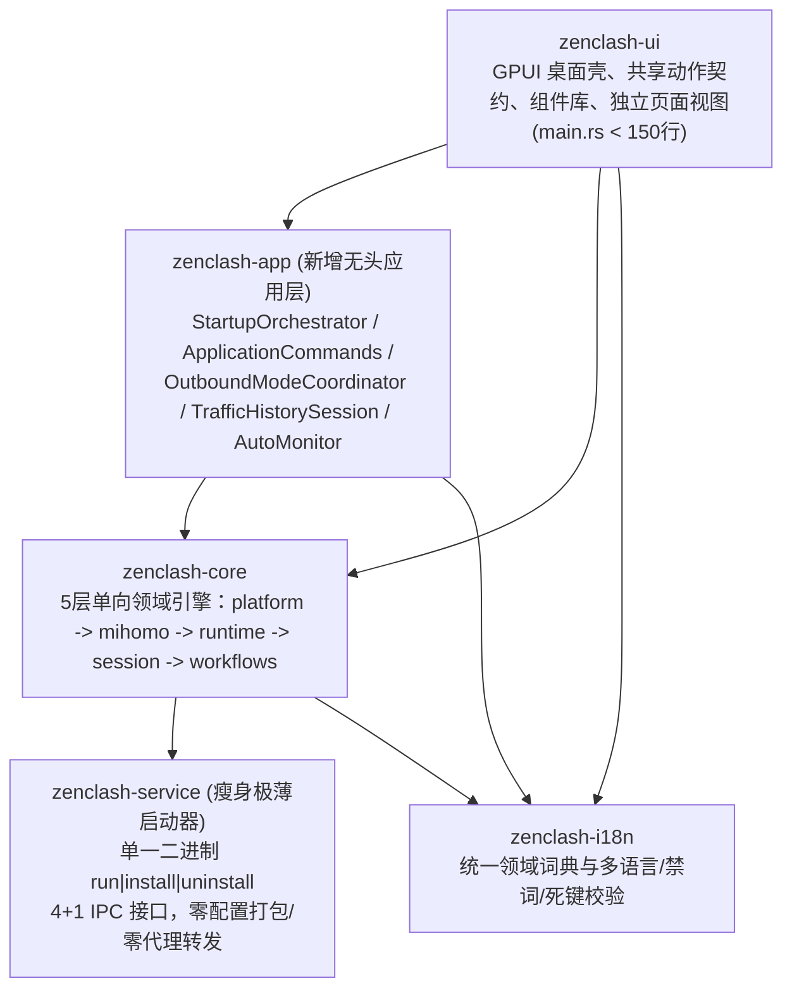
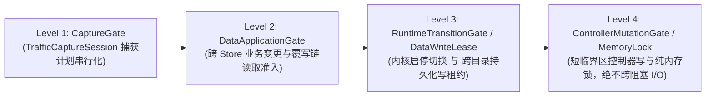
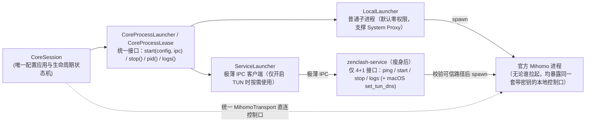
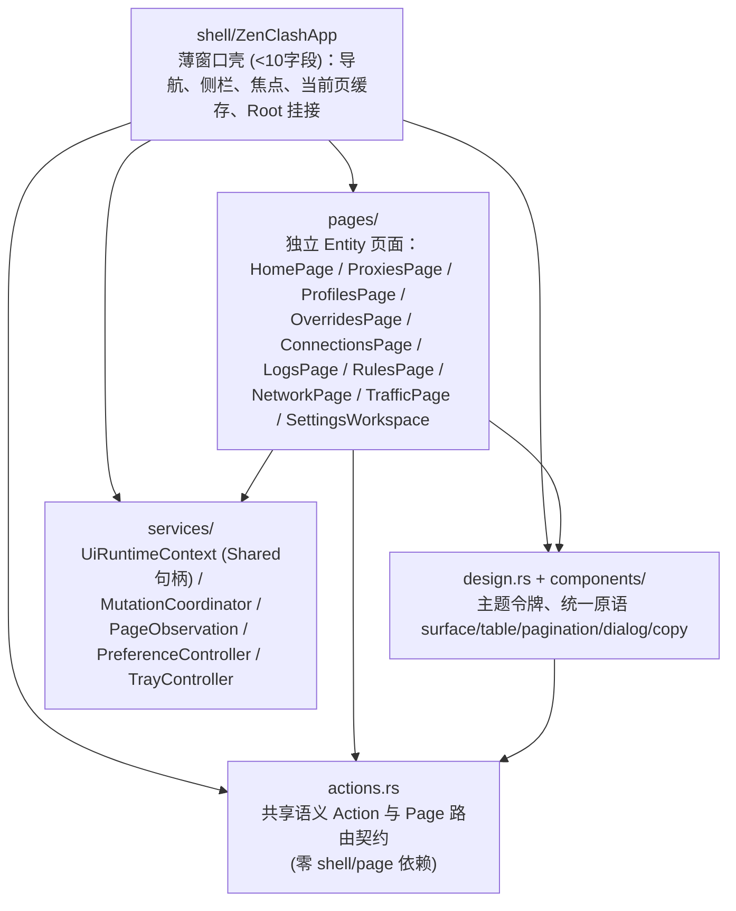

# ZenClash 下一代软件架构设计文档（v2.0 Redesign）

- **文档日期**：2026-11-21
- **适用范围**：`zenclash-core`、`zenclash-service`（瘦身为极薄特权启动器）、`zenclash-app`（拟新增无头应用层）、`zenclash-ui`、`zenclash-i18n`
- **输入依据**：[architecture-review-2026-11-21.md](architecture-review-2026-11-21.md)、[CONTEXT.md](../../CONTEXT.md)、[GLOSSARY.md](../../GLOSSARY.md)、GPUI Kit Coding Guides & Design Guides、FlClash Desktop Helper 架构参考
- **设计目标**：在不破坏现有持久化数据格式、服务安全边界与核心代次不变量的前提下，**根除 P0/P1 级缺陷、切断循环依赖、建立清晰的显式锁序、将重型 TUN Service 瘦身为极薄特权进程启动器、消除 UI 双上帝实体与渲染热路径抖动、对齐三平台原生契约与 WCAG AA 视觉无障碍标准**。

---

## 一、设计原则与核心不变量

保留并强化 ZenClash 现有最宝贵的工程资产，确立 6 条不可妥协的架构铁律：

1. **单向无环分层（Acyclic Layering）**：依赖严格向下指向更稳定、更底层的 crate 与模块；禁止底层反向依赖上层，禁止可复用 UI 组件依赖业务页面或应用壳，禁止通过 crate 根部平铺导出掩盖循环引用。
2. **传输、所有权与编排三权分立**：HTTP/IPC 传输客户端只做请求收发，不拥有内核进程或服务生命周期；业务命令编排与启动恢复不依赖 GPUI；UI 壳只负责窗口、导航与呈现。
3. **代次身份与执行准入显式类型化**：读观察继续使用轻量 `CoreObservationIdentity`；写操作必须通过类型级准入凭证（`&RuntimeAdmission`）方可触达 `CoreSession` / `ControlledConfigStore`，从编译期杜绝覆写链 TOCTOU 绕过。
4. **异步执行器零阻塞**：严禁在 Tokio worker 或 GPUI 前台线程执行同步磁盘 I/O、`canonicalize`、端口扫描、超过 1ms 的 YAML/JSON 解析或 `thread::sleep`；严禁跨 `.await` 或阻塞调用持有同步 `Mutex`。
5. **读写分离与幂等/可逆事务**：所有 `GET` 探测/状态查询必须严格只读无副作用；退出、服务启动、配置切换均遵循“先外部释放/验证，最后不可逆提交”；崩溃恢复优先写清单/WAL（先 `fsync` 再 `rename`）后删旧文件。
6. **原生桌面与可访问性优先**：严格遵守 GPUI Kit Design Guides——单一滚动所有者、标准组件优先、语义令牌满足 WCAG AA（≥ 4.5:1）、键盘全可达、所有交互状态可见且保留旧数据防闪烁。

---

## 二、Workspace Crate 级目标架构

在现有 4 crate 基础上引入无头应用编排层 **`zenclash-app`**，彻底将 4,000+ 行零 GPUI 依赖的编排逻辑从 `zenclash-ui` 中剥离：



### 各 Crate 边界契约
| Crate | 职责边界 | 严格禁止 |
| --- | --- | --- |
| `zenclash-service` | 极薄特权进程启动器（`ping`/`start`/`stop`/`logs` + macOS `set_tun_dns`）、受信任可执行文件校验、对端 PID/UID/SID 鉴权、统一 `install`/`uninstall` 子命令 | 禁止解析/改写 YAML、暂存 GeoData/Provider、转发控制器 HTTP/WS、代管系统代理 |
| `zenclash-core` | 平台原语、Mihomo 协议与配置合成引擎、统一 `CoreProcessLauncher`/`CoreProcessLease`、单一 `CoreSession` 状态机、持久化 Store、备份与遥测 | 禁止耦合 GPUI、窗口、菜单、页面状态 |
| `zenclash-app` | 跨 Store 业务命令（`ApplicationCommands`）、可取消多级启动与恢复编排（`BootstrapOrchestrator`）、出站模式协调、流量历史采集调度、事件驱动自动监控、安全退出协调 | 禁止引入 `gpui-kit`；禁止绕过注入 Store 调用 `::discover()` |
| `zenclash-ui` | 薄入口 `main.rs`（<150 行）、无壳依赖 `actions.rs`、薄 `ZenClashApp` 窗口壳、独立 `TrayController`/`PreferenceController`、设计系统与 `components/`、能力自治 `pages/` | 禁止直接编写多 Store 事务回滚逻辑；禁止 `components`/`pages` 反向依赖 `shell` |
| `zenclash-i18n` | 全仓中英文词典（`app.yml` / `ai_network.yml`）与自动化质量门禁（双语完整性、占位符、反死键、反 `CONTEXT.md` 禁用词） | 禁止在生产业务代码中散落硬编码用户文案或中文标点 |

### 全 Workspace 目标代码组织全景

```text
crates/
├── zenclash-service/              # 极薄特权启动器（~22 文件 / ~4,000 行 / 1 个生产 bin，详见 3.7 节）
│   └── src/{channel,protocol/,client/,daemon/,install/,bin/zenclash_service.rs}
├── zenclash-core/                 # 5 层单向领域引擎（详见 3.1 节）
│   └── src/{platform/,mihomo/,storage/,runtime/,workflows/}
├── zenclash-app/                  # 新增无头应用编排层（纯 Tokio，零 GPUI 依赖，详见第四章）
│   └── src/
│       ├── lib.rs                 # 应用服务组合门面与 AppContext
│       ├── bootstrap/             # 可取消多级启动与恢复状态机（原 ui/main.rs 编排 + startup.rs）
│       ├── commands/              # ApplicationCommands（类型级 Admission 门控，杜绝覆写 TOCTOU）
│       ├── outbound_mode/         # OutboundModeCoordinator + 5s 同步任务
│       ├── traffic_history/       # TrafficHistorySession（跳过空刷盘 + 低频保留期清理）
│       ├── automatic/             # OS 原生事件网络监听 + 边沿触发监控 + 源文件变更扫描
│       └── shutdown.rs            # ShutdownCoordinator（先释放代理与刷盘，最后关闭 CoreSession）
├── zenclash-ui/                   # 纯 GPUI 桌面应用（详见第五章）
│   └── src/
│       ├── main.rs                # <150 行：日志/单实例锁/Runtime/调用 zenclash-app/启动 GPUI
│       ├── actions.rs             # 无壳依赖的共享 Action 与 PageDescriptor 路由契约
│       ├── design.rs              # 满足 WCAG AA 的跨平台主题令牌与对比度单测
│       ├── assets.rs              # 静态图标与品牌资源
│       ├── tray/                  # 原生托盘适配器（token 防误杀）+ 独立 TrayController 实体
│       ├── services/              # UiRuntimeContext / MutationCoordinator / PageObservation / PreferenceController
│       ├── shell/                 # 瘦身后的 ZenClashApp（<10 字段）+ 跨平台窗口控制
│       ├── components/            # 纯可复用 GPUI 原语（surface/table/pagination/dialog/copy/sidebar，不依赖 shell/pages）
│       └── pages/                 # 能力自治独立页面（home/proxies/profiles/overrides/connections/logs/rules/network/traffic/settings）
└── zenclash-i18n/                 # 统一领域词典 + 全文件双语/死键/禁词 CI 测试
```

---

## 三、`zenclash-core` 新软件架构设计

### 3.1 五层单向模块组织（取代 70+ 顶层平铺模块）

将 `crates/zenclash-core/src/` 重构为 5 个清晰层级，并将 `lib.rs` 的 329 个平铺导出收敛为按子域分组的清晰门面（旧顶层兼容别名 `MihomoProcess` 等按迁移窗口废弃）：

```text
crates/zenclash-core/src/
├── platform/                      # Layer 0：纯跨平台基础设施（零领域依赖）
│   ├── command.rs                 # 有界非阻塞子进程执行（原 platform_command）
│   ├── storage_io.rs              # atomic_write / atomic_write_durable(fsync+dirsync) /
│   │                              #   read_bounded_regular_file(O_NONBLOCK+is_file) / quarantine_file
│   ├── private_io.rs              # 统一 Unix 0600+O_NOFOLLOW 与 Windows 当前用户 ACL（抽离自 owner_identity）
│   ├── paths.rs                   # AppDataPaths / BundledResources（原 application_paths）
│   ├── instance_lock.rs           # 单实例进程锁
│   └── autostart/                 # 自启动（Windows 改用 windows-sys 宽字符注册表 API）
│
├── mihomo/                        # Layer 1：纯协议、模型与无状态配置引擎（不拥有进程/服务）
│   ├── endpoint.rs                # MihomoEndpoint（脱敏 Debug + CSPRNG secret）
│   ├── models/                    # 强类型模型（清理未使用的自定义反序列化死代码）
│   ├── transport/                 # 纯 HTTP / Local IPC / Service IPC / WebSocket 传输客户端
│   │   ├── client.rs              # 纯 MihomoTransport（不含 OwnedCore！）
│   │   ├── request.rs             # 有界 JSON 读取 + 按操作类型显式超时策略
│   │   ├── stream_loop.rs         # 统一 WS 骨架（帧上限、读超时、Ping 心跳、代次重连）
│   │   └── http_body.rs           # 唯一有界响应体读取器（network/probe 复用）
│   ├── config_pipeline/           # 单次 Value 态有效配置管线（取代散落的 profile.rs + 10 文件）
│   │   ├── yaml_merge.rs          # expand_yaml_merges / merge_yaml / controlled_replace_rules
│   │   ├── normalize.rs           # TUN 默认项与 GeoX URL 补齐
│   │   ├── project.rs             # TunProjection + ListenerFallback（ipv6 默认 false，错误短路）
│   │   ├── diff.rs                # 基于展开后 serde_yaml::Value 的有界流式预览 Diff
│   │   └── validation.rs          # CoreConfigValidator + validate_clash_yaml（统一先展开 <<）
│   ├── tun_runtime/               # 跨平台 TUN 设备/路由只读观测（Windows 改为环境变量传参或 Win32 API）
│   └── ruleset.rs                 # 规则集转换（临时文件强制 Unix 0600）
│
├── storage/                       # Layer 2：纯持久化仓库与跨目录协调
│   ├── coordinator.rs             # DataWriteLease（锁外路径解析、authorized 返回 Result）
│   ├── profiles/                  # ProfileStore（纯 CRUD/索引/下载/调度，无磁盘 staging 往返）
│   ├── overrides.rs               # YamlOverrideStore（先写清单后删文件、元数据与内容分离、大小写不敏感查重）
│   ├── controlled.rs              # ControlledConfigStore（按路径共享 mutation_gate 与 session_listener_fallbacks）
│   ├── preferences/               # AppPreferencesStore + migration + observation
│   ├── traffic_history/           # SQLite 长连接复用 + 节流裁剪 + 覆盖索引
│   └── backup/                    # 流式 ZIP 导出 + 按类型/剩余预算限流导入 + 大小写不敏感查重 + WAL 恢复
│
├── runtime/                       # Layer 3：内核运行态所有权与统一 CoreSession
│   ├── launcher.rs                # 统一 CoreProcessLauncher / CoreProcessLease trait（抹平 Local 与 Service 差异）
│   ├── owner.rs                   # KernelOwner 枚举：External | Managed(CoreProcessLease)（取代 OwnedCore 寄生于 client）
│   ├── local/                     # LocalLauncher / ManagedCoreProcess + core_installation + core_update（PATH 扫描跳过 EACCES/ENOTDIR）
│   ├── service_launcher/          # 瘦身后的极薄 ServiceLauncher 客户端（取代原 4 层 service/service_runtime/service_runtime_session 胶水）
│   └── session/                   # 瘦身后的 CoreSession + CoreObservationIdentity + RunState + 统一 commit_generation_change
│                                  #   （不反向依赖 TrafficCaptureSession，通过 hook/watch 广播状态）
│
└── workflows/                     # Layer 4：面向应用层的高层业务工作流与遥测
    ├── config_apply/              # AdmittedRuntimeContext 统一准入：FullApply / PartialApply / ExactRestore / ProfileTx
    ├── capture/                   # TrafficCaptureSession + SystemProxySession（收敛旧 API；修复 Linux int32 & Windows WinINET & 事件驱动 PAC）
    ├── service_manager/           # 服务安装/维护/TUN 编排（移除冗余 command 锁）
    ├── operations/                # ProxyOperations（全方法校验 observation_identity、并发关连接）/ ProviderOperations（并发更新单次读回）
    ├── telemetry/                 # TrafficMonitor（断线归零）/ LogMonitor（懒启动批写+流式行对齐压缩+O_NOFOLLOW）/
    │                              #   OperationalStatus（impl Drop + 代次变更立即刷新平台 + 条件拉 /configs）
    └── diagnostics/               # NetworkProbe（IPv6 加括号）/ NetworkDiagnostics / AiNetwork / AppUpdate
```

### 3.2 并发与锁序治理（先显式锁序，再按域精简）

> 注（基于第二轮复核修正）：原方案将所有异步互斥锁粗暴合并为单一 `SessionGate` 会把长事务与短控制器写操作串行化，且存在死锁风险。正确做法是**先绘制全局持锁图并强制单一获取顺序**，再仅移除真正冗余的重叠锁。



**关键约束**：
1. **全局单向锁序 + 仅消去真冗余**：严格禁止逆序加锁；移除与 `RunStateStore::begin_operation` 重复的 `ServiceManager::command` 本地锁，以及随 Service 瘦身后不再需要的 `ControlledConfigStore::service_tun_mutation`；保留 `DataApplicationGate`（长业务准入）与短控制器写锁的职责隔离，避免阻塞只读观测。
2. **严禁在 `DataWriteLease` 内做网络 I/O**：`ProfileApplication` 执行远程下载采用三步走：**① 无锁读取源元数据 → ② 无锁下载与内存校验 → ③ 申请准入与 `DataWriteLease` 执行 CAS 校验与原子提交**。
3. **消除 `ManagedCoreProcess` 3 秒同步阻塞**：将子进程生命周期状态（`pid`, `running`, `exit_status`）维护为原子/无锁观测快照，由独立后台 reaper 持有 `Child`，使 `snapshot()`/`try_snapshot()` 成为 $O(1)$ 无阻塞调用；`Drop` 仅触发异步/非阻塞终止信号。
4. **显式化 macOS `sync_tun_dns`（防回归）**：`service/session.rs:370` 的 `GET /configs` DNS 同步是有意为 2026-10-10 macOS DNS 回归设置的防护，**不得简单删除**；需将其抽为显式 `sync_tun_dns(enabled)` 步骤，强制挂接在每一次配置接纳点（首次启动、热重载、局部 TUN 变更、恢复提交）之后，并补回归测试同时验证“只读 `GET /configs` 无写副作用”与“接纳后系统 DNS 必同步”。

### 3.3 `EffectiveConfigPipeline` 单次 `Value` 合成引擎

将当前高达 12 次全量 YAML 解析/序列化的字符串往返，重构为强类型的单次内存管线（整段运行于 `spawn_blocking`）：

```rust
pub struct EffectiveConfigPipeline;

// 1. Parse once (+ expand_yaml_merges on all inputs)
// 2. Merge controlled override (with explicit replace keys: hosts, dns.nameserver-policy)
// 3. Merge ordered YAML override chain
// 4. Normalize (TUN defaults, fake-ip DNS, geox-url)
// 5. Project runtime policy (non-elevated Local TUN projection + listener_fallback on Value)
// 6. Validate & Serialize once -> EffectiveArtifact { yaml: Arc<str>, fallbacks: SessionListenerFallback }
```

- **局部更新（Partial Apply）**：`contains_delta` 直接在 `serde_yaml::Value` 上比较，不再转 `serde_json::Value`；当服务端 `effective_delta()` 补全额外字段时，必须重跑覆写冲突检测。
- **服务启动回退端口事务化**：`prepare_service_startup_payload` 返回 `EffectiveArtifact`，其中的 `fallbacks` 仅在内核接受并提交 `RuntimeCacheTransaction` 时才写入按路径共享的 `session_listener_fallbacks`。

### 3.4 三平台原生基础设施契约修正

| 平台 | 模块 | 新设计方案 |
| --- | --- | --- |
| **Windows** | `tun_runtime` | 短期通过子进程环境变量 `ZENCLASH_TUN_DEVICE` 传递设备名并校验白名单字符集（彻底封堵 `-Command` 注入与 `$args[0]` 失效）；中期直接使用 `windows-sys` 调用 `GetAdaptersAddresses` + `GetBestRoute2`，零子进程、毫秒级延迟。 |
| **Windows** | `system_proxy` | **先在 Windows 实机抓包验证 `InternetSetOptionW` 注册表前后差异**；若确认空 `AutoConfigURL` 被删除，则改用单次 `INTERNET_PER_CONN_OPTION_LISTW` 批量提交并按 WinINET 语义校验受管键（空串等价删除），未受管键保持原样对比。 |
| **Windows** | `autostart` / `reachability` | 注册表自启动直接调用宽字符 `RegQueryValueExW`/`RegSetValueExW`/`RegDeleteValueW` 消除 OEM/UTF-16 编码损坏；IPv6 上行检查补齐 `is_unspecified`/`is_loopback`/`is_unicast_link_local` 过滤。 |
| **Linux** | `system_proxy` | 修正 `org.gnome.system.proxy.{http,https}.port` 为 `int32 ("i")`（范围 `0..=65535`），同步修正测试 GSettings schema 夹具与启用判定（`mode == "manual" && !host.is_empty() && port != 0`）。 |
| **Linux** | `service_bundle` | 全部 GeoData（`GeoIP.dat`/`geoip.dat`/`geosite.dat`/`GeoSite.dat`/`ASN.mmdb`/`Country.mmdb`/`geoip.metadb`）统一采用大小写无关目录扫描。 |
| **全平台** | `pac/http.rs` | 改用阻塞 `accept()` + 关闭时 self-connect 唤醒（或 Tokio `TcpListener` + 并发上限 8），彻底消除 200Hz 空转耗电与单连接阻塞。 |

### 3.5 遥测与存储性能优化设计

1. **`TrafficHistoryStore`（SQLite）**：
   - `TrafficHistoryStore` 内部持有受控 `Mutex<Option<Connection>>` 复用长连接，仅在首次打开执行 `PRAGMA` + DDL；`DataWriteLease::exclusive`（备份恢复）通过回调显式关闭连接释放文件句柄。
   - `TrafficHistorySession` 在 `pending.is_empty()` 时跳过每 5 秒刷盘；将保留期与 100 万行裁剪解耦为每写入 1,000 行或每 1 小时执行一次，并用 `OFFSET 1000000` 阈值删除替代全索引 `COUNT(*)`。
   - 精简索引为 `(timestamp_ms, upload, download)` 覆盖索引 + 按需下钻索引，降低写放大并加速 `overview`。
2. **`LogMonitor` & `LogsFileWorker`**：
   - 仅在 `persistence.enabled == true` 时懒启动写盘线程，`Drop` 时发停止信号并 `join()`。
   - 写盘循环用 `try_recv()` 批量合并最多 64 条 / 64 KiB 后单次拿租约写入；Unix 打开补 `O_NOFOLLOW` + `is_file()` 校验；压缩改为流式临时文件分块拷贝 + 按首个 `\n` 对齐，零内存峰值且不再因单字节非法 UTF-8 清空全量日志。
   - 内存预算直接采用原始 WS 帧长度，消除每条日志二次 `serde_json::to_vec`。
3. **`OperationalStatus` & WebSocket 流**：
   - 补齐 `impl Drop for OperationalStatus`；监听 `CoreSession` 代次变化与 `TrafficCaptureSession` 意图变更即时唤醒平台刷新，消除 30 秒 TUN 盲区；仅在 `refresh_platform` tick 才调用 `GET /configs`；内存采集优先复用 `connections.memory`。
   - 抽象通用 `ControllerStreamLoop` 统一管理 `/traffic`、`/logs`、`/memory`：全流设置 `WebSocketConfig` 体积上限 + 读超时 / Ping 心跳；`/traffic` 断线或切换代次时瞬时速率清零；`logs.rs` 修正 `borrow_and_update()`。

### 3.6 TUN 权限与特权 Service 瘦身设计（极薄特权进程启动器方案）

ZenClash 当前沿用 Clash Verge 的重型 Service 架构（`zenclash-service` + `zenclash-core` 4 层 `service*` 模块合计约 3 万行），导致维护成本极高，且存在 `Local` / `Service` 双轨状态机撕裂、资源包二次打包、缓存导出竞态等一系列复杂度痛点。

吸收 FlClash（`services/helper` + `CoreProcessLauncher` / `CoreProcessLease`）的工程精髓，同时**保留 ZenClash 支持官方 Mihomo 二进制与受信任目录校验的安全优势**，确立“**极薄特权启动器 + 统一进程租约**”的目标方案：

#### 1. 架构收敛：Service 只做 3 件事，彻底消解双轨运行态



- **`zenclash-service` 职责硬边界（仅 3 件事）**：
  1. **可信可执行文件校验**：校验即将拉起的 Mihomo 位于受保护可信目录（普通用户不可写）或匹配已确认校验和；
  2. **提权进程生命周期（`start` / `stop` / `logs`）**：按 `session_id` 托管唯一 Mihomo 子进程并返回 `{ session_id, pid }`，不解析/修改 YAML，不搬运 GeoData/Provider 缓存；
  3. **必要特权网络动作**：目前仅保留 macOS 的 `set_tun_dns(enabled)`（直至上游 Mihomo 原生解决 macOS TUN DNS 接管问题）。
- **彻底从 Service 剥离的能力**：
  - 废除控制器 HTTP/WS 经由 Service 代转发（Mihomo 启动后由 `MihomoTransport` 直连受权限保护的本地控制口 + 256-bit 随机 secret，单次控制请求从 3–5 次 IPC 降至 1 次直连）；
  - 废除 `ServiceRuntimeBundle` 资源冻结双轨复制与 `stop_and_export` 缓存导出（改由单一受控工作目录 + 明确文件属主归还机制共享）；
  - `CoreSession` 不再区分两套配置应用路径，只通过统一的 `CoreProcessLease` 管理内核启停与崩溃恢复。

#### 2. 极薄 Service 最小协议契约

| 接口 | 输入 | 输出 / 语义 | 安全与生命周期约束 |
| --- | --- | --- | --- |
| `ping` | `{ protocol_version }` | `{ service_version, helper_path, active_session }` | 只读健康检查，不触发任何提权或配置写操作 |
| `start` | `{ session_id, core_path, home_dir, config_path, controller_ipc }` | `{ session_id, pid }` | 先按 `owner` 校验对端身份，校验 `core_path` 可信且防 TOCTOU（Windows 持 `FILE_SHARE_READ` 句柄至 `spawn` 完成），释放旧托管进程后再拉新进程 |
| `stop` | `{ session_id }` | `{ stopped, exit_confirmed }` | 严格匹配 `session_id`（不匹配返回 `409 Conflict`）；Unix 先发 `SIGTERM` 等 3s 让 `sing-tun` 清理策略路由再 `SIGKILL` |
| `logs` | `—` | 有界最近 stderr 环缓冲（最多 100 行 / 2 MiB） | 用于启动失败诊断 |
| `set_tun_dns` *(仅 macOS)* | `{ session_id, enabled }` | `{ applied }` | 仅由配置接纳流程显式调用，严禁挂在只读 `GET /configs` 上 |

#### 3. 三平台工程加固细节（吸收 FlClash 实践）

| 平台 | 服务/提权策略 | 关键加固点 |
| --- | --- | --- |
| **Windows** | 极薄 Windows SCM 服务（`AutoStart`，按需安装） | ① **Job Object (`JOB_OBJECT_LIMIT_KILL_ON_JOB_CLOSE`)**：绑定受管 Mihomo，Service 崩溃时内核自动清理子进程与 TUN，杜绝孤儿进程；<br>② **对端 SID 鉴权**：安装时由 App 传 `--owner-pid <pid>` 读取调用账户 SID 并持久化给服务启动参数，连接建立时校验对端进程 SID == `owner_sid`；<br>③ **消除固定端口冲突**：使用 Named Pipe（或若用回环 TCP 则 `127.0.0.1:0` 动态端口 + `HKLM\...\Services\<Name>\Runtime\Port` `REG_OPTION_VOLATILE` 发布，防 Hyper-V / WinNAT 端口保留冲突）；<br>④ 拒绝 `Origin` 头与非本机 `Host` 头防浏览器 DNS Rebinding。 |
| **Linux** | 极薄 systemd 服务（或可选轻量化演进：`setcap`） | ① **提权降级链**：优先 `pkexec`；当 `pkexec` 缺失或退出码 `127`（平铺窗口管理器无 polkit agent）自动回退 `sudo -n` → 应用内密码框 `sudo -S`（退出码 `126` 视为用户取消不再重试）；<br>② **防解压目录提权**：安装前强制校验 Helper 二进制及其父目录为 `root` 所有且 `mode & 0o022 == 0`；<br>③ **不污染用户家目录属主**：`pre_exec` 设置 `setresgid(owner_gid, 0, 0)` + `setresuid(owner_uid, 0, 0)`，或按 `SO_PEERCRED` UID 隔离运行时文件属主；<br>④ **AppImage 明确不可授权**：检测 `APPIMAGE` 环境变量（FUSE `nosuid` 挂载）直接提示用户改用系统包；<br>⑤ **备选极简路径（值得评估）**：对普通 Linux 发行版，给受管 Mihomo 赋予最小能力 `setcap cap_net_admin,cap_net_bind_service+ep` 即可零常驻服务、零 root 属主污染地运行 TUN（仅需更新内核后重新 `setcap` 一次）。 |
| **macOS** | 保留极薄 `launchd` 服务（不回退 `4750` setuid） | ① ZenClash 支持用户更新/替换官方 Mihomo 二进制，保留极薄 `launchd` Helper 可避免每次升级内核重输管理员密码，且维持比 `4750` 更小的同组提权面；<br>② 校验 `LOCAL_PEERPID` / `SO_PEERCRED` UID 仅放行安装账户；<br>③ 显式提供 `set_tun_dns` 供配置接纳阶段调用；未来若上游 Mihomo 合入原生 macOS `tun.dns-mode: native` 可直接退役该接口。 |

#### 4. 产品交互减压：按需延迟授权

- **零权限默认体验**：应用安装与首次启动时**绝不自动注册/弹窗安装后台服务**，默认以 `LocalLauncher`（零权限普通进程）运行并支持 System Proxy。
- **按需一次性授权**：仅当用户在界面**主动开启 TUN 模式**且探测到服务未就绪时，才弹出清晰说明并触发一次性提权安装；关闭 TUN 或卸载应用时提供一键干净卸载入口。
- **代码删减预期**：落地后可移除/合并现有 `zenclash-core` 侧的 `service/runtime_bundle.rs`（663L）、`service_runtime/*`（~1,413L）、`service_runtime_session/cache.rs` 及控制器代转发层，并将 `crates/zenclash-service` 从 **53 文件 / 18,202 行 / 3 个生产二进制** 瘦身至 **~22 文件 / ~4,000 行 / 1 个统一二进制**（净减 **65%–75%**）。

### 3.7 `crates/zenclash-service` 全新代码文件组织结构图

将原有 3 个分离生产二进制（`zenclash-service`、`zenclash-service-install`、`zenclash-service-uninstall`）合并为**单一二进制 `zenclash-service`**（通过 `run` / `install` / `uninstall` 子命令驱动，借鉴 FlClash），去掉 YAML 解析、资源暂存、系统代理代管和冗余日志栈：

```text
crates/zenclash-service/
├── Cargo.toml                     # 精简依赖：移除 serde_yaml、sysproxy(git)、tracing-estuary(git)、flexi_logger；
│                                  #   统一仅用 tracing + tracing-subscriber；合并为 1 个生产 [[bin]]
└── src/
    ├── lib.rs                     # 极薄门面：仅导出 protocol / channel / client(feature="client")
    ├── channel.rs                 # 通道标识（正式/dev 服务名、Socket/Pipe 路径、版本常量）
    │
    ├── protocol/                  # 共享 Wire 契约（client 与 daemon 共用，零平台 I/O 依赖）
    │   ├── mod.rs                 # ProtocolVersion、错误码 ServiceErrorCode、常量
    │   └── messages.rs            # 4+1 精简 DTO：Ping / Start / Stop / Logs / SetTunDns（取代 512L structure.rs）
    │
    ├── client/                    # feature = "client"：供 zenclash-core::runtime::service_launcher 调用
    │   ├── mod.rs                 # ServiceClient（ping / start / stop / logs / set_tun_dns）
    │   ├── transport.rs           # 跨平台本地 IPC 连接（Unix Socket / Windows Named Pipe + 对端校验）
    │   └── installer.rs           # 拉起 `zenclash-service install/uninstall`（Win ShellExecuteW / Linux pkexec->sudo / macOS 授权）
    │
    ├── daemon/                    # feature = "standalone"：常驻特权服务核心（无配置合成、无代理转发）
    │   ├── mod.rs                 # 服务主循环、优雅停机（SIGTERM/SIGINT/SCM Stop）与状态发布
    │   ├── server.rs              # 精简 IPC 路由分发（仅 4+1 端点 + 4 KiB 请求上限 + Host/Origin 防护）
    │   ├── auth.rs                # 对端身份鉴权（Unix SO_PEERCRED/LOCAL_PEERPID + Windows 对端 SID/Token）
    │   ├── supervisor.rs          # 单一受管 Mihomo 进程所有权：session_id 校验、会话心跳租约、SIGTERM 3s 优雅退 + 环缓冲日志
    │   ├── trusted_core.rs        # 受信任 Mihomo 可执行文件校验（可信目录属主/不可写校验 + 句柄锁定防 TOCTOU）
    │   └── platform/              # 严格按目标 OS 条件编译的平台隔离层
    │       ├── mod.rs
    │       ├── windows.rs         # Windows SCM 生命周期 + Job Object (KILL_ON_JOB_CLOSE) + 安全描述符/ACL
    │       ├── linux.rs           # systemd 单元托管 + setresuid(owner, 0, 0) + /run socket 0660 权限
    │       └── macos.rs           # launchd 托管 + tun_dns.rs（SCDynamicStore 显式同步与回滚，原 core/tun_dns.rs）
    │
    ├── install/                   # feature = "standalone"：`install` / `uninstall` 子命令实现（取代 1,722L 两套 bin）
    │   ├── mod.rs                 # 统一安装/卸载事务入口与目录权限校验
    │   ├── windows.rs             # SCM 注册/失败重启策略/卸载等待 + 记录 --owner-sid
    │   ├── linux.rs               # 校验 root 属主防解压提权 + 写 systemd unit + SELinux 上下文（原 installer/selinux.rs）
    │   └── macos.rs               # launchd plist 写入/激活与卸载清理
    │
    ├── bin/
    │   └── zenclash_service.rs    # 唯一生产入口：解析 `run | install | uninstall` 分发（<80 行）
    │
    └── tests/                     # 测试辅助与集成夹具（不再把 4 个测试 bin 混在生产 src/bin/）
        ├── ipc_contract.rs        # 协议、鉴权、session_id 409、日志上限回归
        └── fixtures/              # mock_core / crash_core（通过 integration test 或 dev-only target 构建）
```

#### 现有 `crates/zenclash-service`（53 文件 / 18,202 行）去留对照表

| 处理动作 | 现有模块 / 文件 | 行数 | 原因 |
| --- | --- | ---: | --- |
| **彻底删除** | `core/runtime_generation/{assets,staging,readback,mod}.rs` | 2,174 | Service 不再打包/暂存/回读配置与 GeoData，由 `zenclash-core` 唯一管理 |
| **彻底删除** | `core/proxy.rs`（及 `sysproxy` git 依赖） | 491 | 系统代理已由 `zenclash-core::system_proxy` 统一负责，Service 不重复代管 |
| **彻底删除** | `core/desired.rs`、`core/reconcile.rs`、`core/repair.rs`、`core/maintenance.rs` | 1,085 | Service 退化为无持久化业务意图的纯进程启动器，业务意图由 `CoreSession` 单一拥有 |
| **彻底删除** | `core/legacy_cleanup.rs`、`core/windows_legacy_cleanup.rs`、`core/windows_security/legacy_repair.rs` | 616 | 历史旧版迁移清理代码，v2 协议升级后一并退役 |
| **大幅瘦身合并** | `core/server.rs`（1,447L）+ `core/manager.rs`（1,254L）+ `core/process.rs`（495L）+ `core/owner*.rs`（462L）+ `execution*.rs`（1,075L） | 4,733 → ~1,200 | 收敛为 `daemon/{server,supervisor,auth,platform/*}.rs`，去除控制器转发与多层状态机 |
| **合并精简** | `bin/install_service.rs`（1,431L）+ `bin/uninstall_service.rs`（291L）+ `bin/service.rs`（244L）+ `management.rs`（672L）+ `macos_activation.rs`（430L）+ `windows_activation.rs`（505L） | 3,573 → ~1,000 | 合并为单一入口 `bin/zenclash_service.rs` + `install/{windows,linux,macos}.rs` + `client/installer.rs` |
| **保留精炼** | `channel.rs`、`core/tun_dns.rs`、`core/trusted_core_location.rs`、`core/auth.rs`、`bin/installer/selinux.rs` | ~1,800 → ~1,100 | 保留核心安全资产（可信目录校验、对端 PID/UID/SID 鉴权、SELinux、macOS TUN DNS），移除冗余依赖 |

> **依赖瘦身收益**：`crates/zenclash-service/Cargo.toml` 可直接移除 `serde_yaml`、`sysproxy`（外部 git 依赖）、`tracing-estuary`（外部 git 依赖）、`flexi_logger` 与 `log`，不仅显著缩短编译时间，还消除了两个非 crates.io 固定 commit 的供应链维护风险。

---

## 四、`zenclash-app`（无头应用编排层）设计

将原散落在 `zenclash-ui/src/{main.rs, startup.rs, application_commands*, outbound_mode/coordinator.rs, app/traffic_history.rs, app/automatic*}` 的无头逻辑收拢为清晰的应用服务：

1. **`BootstrapOrchestrator`（可取消启动状态机）**：
   - 显式建模 `StartupOutcome::{Ready(AppContext), Offline(AppContext, String), Cancelled, Failed(String)}`；取消信号以 `CancellationToken` 贯穿资源准备、服务探测、`wait_until_ready` 与恢复循环，取消直接短路退出，绝不被 `.or_else` 吞噬。
   - Pending 阶段仅构建轻量只读 `PendingContext`（不启动 `127.0.0.1:0` 的 `TrafficMonitor`/`LogMonitor` 与写盘线程）。
2. **`ApplicationCommands`（类型级准入门控）**：
   - 所有会改变有效配置的入口（`apply_profile`、`reapply_current`、`apply_controlled_patch`、`apply_overrides`、`restore_backup`）统一在内部获取 `CoreDataApplicationAdmission` 后才读取最新 `enabled_overrides()`，消除一切覆写链 TOCTOU 竞态。
   - 持有唯一已注入的 `ProfileStore`、`YamlOverrideStore`、`ControlledConfigStore`、`AppPreferencesStore` 实例，全仓禁止运行期再次调用 `::discover()`。
3. **`AutomaticRuntimeMonitor`（边沿触发）**：
   - `EdgeStableObservation<T>` 维护 `{ candidate: Option<T>, committed: Option<T> }`：仅当连续 2 次观测一致且 `!= committed`（或存在待重试错误且到达退避窗口）时才调用 `suspend_for_network` / `resume_after_network`；同时 `CoreSession` 侧在加锁与暂停 PAC 前先做原子快速路径检查，彻底消除 1Hz 抖动。
4. **`ShutdownCoordinator`（安全退出状态机）**：
   - 严格三阶段顺序：**① 释放捕获（`capture.release_owned()`）& 刷新历史（`history.shutdown()`） → ② 全部成功后才调用 `core_session.request_shutdown()` + `core_session.shutdown()` → ③ 通知 UI `cx.quit()`**。
   - 若阶段 ① 失败，直接回退 `QuitState::Blocked`（提供“重试退出 / 取消退出恢复运行”入口），`CoreSession` 保持 100% 健康可交互。

---

## 五、`zenclash-ui` 新架构与视觉系统设计

### 5.1 消除循环依赖与双上帝实体



1. **打破 `app <-> components` 与 `app <-> pages` 循环**：
   - 抽取顶层 `actions.rs` 存放共享命令（用带载荷或精简命令替代 16 路重复 `Navigate*` 样板，并定义 `PageDescriptor` 声明每页标题、副标题、滚动策略、页边距策略，消灭 `workspace.rs` 与 `view.rs` 散落的 `if page == ...` 特判）。
   - `Sidebar` 与各页面只依赖 `actions.rs`，不再 `use crate::app::*`。
2. **拆解 `ZenClashApp`（42 字段 → <10 字段）**：
   - **`TrayController`（独立 `Entity` + `tray/` 顶层模块）**：为 `TrayMenuState` 实现 `PartialEq` 做增量 diff；防抖 150ms；macOS 右键优先立即弹出最新缓存菜单同时后台刷新；为 `NetworkTrayIcon` 增加唯一 `u64` token 防止 `Drop` 误杀新实例的全局 `NATIVE_EVENT_SENDER`；合并托盘命令队列（`SystemProxy` 队列精简为 `bool`）。
   - **`PreferenceController`（合并 `preference_previews` / `menu_preferences` / `preferences`）**：同字段写队列合并最新意图；保存菜单偏好直接返回 `AppPreferencesObservation` 并按窄作用域（`Appearance` / `TrayVisibility`）生效，消除 `PreferenceScope::Restore` 副作用风暴；对账读改为指数退避（上限 10 次）。
   - **所有常驻任务收归 `_tasks: Vec<gpui_kit::Task<()>>`**：在 GPUI `cx.spawn` 中统一使用 `cx.background_executor().timer(...)`（或将纯后台循环迁入 `zenclash-app` Tokio 任务），彻底消除任务泄漏与隐式主线程 `runtime.enter()` 依赖。
   - **就地切换启动态**：废除 `adopt_startup` 中的 `*self = Self::new(...)`，改为 `ShellState::Initializing | Ready | Failed` 原地注入服务句柄，保留偏好保存状态与窗口可见性。
3. **拆解 `RuntimePage`（47 字段 / 15 页单体 → 能力自治多页面）**：
   - **第一批直接提升**：`ConnectionsView`、`LogsView`、`RulesView` 本身已是独立 `Entity`，直接提升为顶层页面，拆除 `RuntimePage` 中的 6 个桥接观察者与外层双滚动条。
   - **第二批高频独立**：抽离 `HomePage`（500ms 刷新隔离，删除 773 行死模块与零消费者 `connection_samples`，每帧仅采样 1 次快照并缓存图表点序列）、`ProfilesPage`（用单调 `catalog_revision: u64` 替代裸指针 ABA 检查，补齐远程表单超时/Cron 渲染与对话框守卫）、`OverridesPage`（后台预切片 `SharedString` 预览）。
   - **第三批整合设置域**：抽离 `NetworkPage`、`TrafficPage`、`SettingsWorkspace`（承载 General / SystemProxy / Tun / Dns / Sniffer / Resources / Mihomo，按当前子分区懒初始化 `ConfigInputs`，输入框自带 `placeholder_key` 消除 `lifecycle.rs` 100 行重复清单，补全 `Page::Mihomo` 取消重置与 `tun.mtu`/`geoip` 清空语义）。
   - **治理 `ProxiesPage`**：构造期接收 `window: &mut Window` 消除渲染期实体创建与订阅；移除 `observe_self` 无条件 `invalidate_measurements()` 解除重测死回环；保留上一份 `search_projection` 防止搜索/测速闪烁（非排序/隐藏模式下测速不重跑搜索）；按 `ProxyNodeId` 跨组去重测速、写入 RFC3339 时间戳并同步失败态到详情页。

### 5.2 视觉设计系统与组件库升级（对齐 GPUI Kit Design Guides）

1. **修正 `design.rs` 语义对比度与跨平台基础度量**：
   - **WCAG AA 对比度修正**（全量纳入单元测试门禁）：
     - 浅色 `success_foreground` / `warning_foreground` / `danger_foreground` 改为 `LIGHT_PANEL (#FFFFFF)`（对比度分别提升至 **5.38:1 / 4.93:1 / 5.32:1**）。
     - 深色 `info_foreground` 改为 `DEEP_INK (#10161D)`（对比度由 2.45:1 提升至 **7.42:1**）。
   - **字体与层次**：按目标 OS 保留 GPUI Kit 原生系统字体族（或分平台 `cfg` 回退：macOS `SF Mono`、Windows `Cascadia Mono`/`Consolas`、Linux `monospace`）；恢复 `theme.radius = px(6.)` < `theme.radius_lg = px(10.)` 同心圆角；恢复 `theme.shadow = true`（仅平面卡片不加阴影，Dialog/Popover/Menu 保留浮层阴影）。
   - **语义令牌纯净化**：新增产品语义 token（如 `brand_accent` / `online_indicator`），严禁将 `theme.chart_3` 用于开关或侧栏在线点；移除 `sidebar.rs` 对 `is_settings()` 的条件染色。
2. **组件收口与单一滚动所有者**：
   - 优先回归 `gpui-kit` 标准组件：用主题化 `Switch` 替代 `MintSwitch`、用 `Select` 替代 175L `ChoicePopover`、用 `TabBar` 替代手写标签页、用统一 `PaginationBar` 替代两套手写分页、用带 toast 反馈的 `CopyButton` 替代无反馈复制按钮。
   - 在 `components/surface.rs` 收口唯一卡片容器（替换 5 套重复 `panel`/`setting_card`/`network_card`）、统一 `detail_row`、`status_pill`、`centered_dialog` 与标准表格列宽定义（所有固定列加 `.flex_shrink_0()`、行尾统一固定宽度动作槽）。
   - `Connections` / `Rules` / `Logs` 独占视口垂直滚动（外层 `flex_1().min_h_0().overflow_hidden()`），表单页各自持有独立 `ScrollHandle`。
   - 数据投影统一策略：仅文本搜索做 80ms debounce，按钮/标签/排序与实时快照 0ms 立即投影且**保留上一份有效 `projection` 直至新结果就绪**；`ConnectionTimeline::observe` 改为 $O(N)$ `HashSet` 去重批量合并；`RulesView` 后台预计算计数并用 `BTreeSet<&str>` 去重，同时将 `confirmed_disabled` 纳入“仅已禁用”过滤。
3. **无障碍与 i18n 治理**：
   - 恢复 `settings_switch_disabled` / `settings_input_row` 的 `description` 渲染；统一侧栏主题按钮可见文本、tooltip、a11y 名称，折叠态才显示导航 tooltip，宽度放宽至 `rems(13.)`；Traffic 列表行改用可聚焦按钮并移除 `.cursor_pointer()`；补齐弹窗作用域 `ElementId`、表单 `accessibility_label` 与具体化破坏性确认文案（`AlertDialog` + `Danger` + 目标对象名）。
   - `zenclash-i18n`：将托盘延迟格式接入 i18n；测试覆盖 `locales/*.yml` 全文件（含 `ai_network.yml`），新增 CI 静态门禁检查**死键（清理 415 条废弃键）**与 **`CONTEXT.md` 禁用词（清理 14 处漂移）**；逐步合并 `redesign.*`/`settings_redesign.*`/`unified.*` 并统一英文 Sentence Case。

---

## 六、工程基础设施与桌面原生细节增强（吸收 FlClash 实践）

除 3.6 节的极薄特权启动器之外，进一步吸收 FlClash（及其 Rust 桌面适配层 `plugins/rust_api`）的 7 项成熟工程实践，补齐 ZenClash 在长期可维护性、开发效率与桌面原生体验上的短板：

### 6.1 架构边界“传递闭包”守护测试（防重构后再次腐化）
- **机制**：在 CI 测试套件中新增静态架构守护测试（不依赖外部工具，纯 Rust 扫描 `src/` `use` 图）：
  1. 校验 `zenclash-core` 与 `zenclash-ui` 顶层模块依赖图 **0 双向环**；
  2. 沿**完整传递闭包**校验 `zenclash-ui/src/components` 与 `zenclash-ui/src/actions.rs` 绝不牵入 `pages` 或 `shell`；
  3. 禁止 `zenclash-ui` / `zenclash-app` 生产代码在启动之外调用 `ProfileStore::discover()` / `YamlOverrideStore::discover()`；
  4. 校验受控配置字段的热更新集合与全量重载集合互不重叠。

### 6.2 编译期 / 启动期 `Safe Mode`（开发版与正式版和平共处）
- **机制**：引入 `safe-mode` 特性或显式启动标志（如 `--safe-mode` / `ZENCLASH_SAFE_MODE=1`）。开启后在各宿主副作用入口统一短路，**绝不改动宿主机状态**：
  - 不修改系统代理、不装/不碰特权服务、不启 TUN、不写开机自启、不改系统 DNS、不占用默认生产端口（7890/9090）；
  - 使用隔离数据目录与直连/只读降级，并在窗口顶部展示醒目 `SAFE MODE` 横幅与专用托盘图标。
- **收益**：开发者可在正在运行正式版 ZenClash 的日常机器上直接调试 UI 与业务流程，彻底摆脱“单内核互斥锁阻断调试与集成测试”的痛点。

### 6.3 最新期望意图收敛器（Latest-Desired-Intent Reconciler）与 `leftover` 清理
- **内核生命周期收敛**：将 `CoreSession` 的启停/重启从串行命令队列演进为单调 `revision` 的期望状态收敛器（目标态：`Running | Stopped | Closed`），单 worker 每次朝最新目标推进一步，返回 `Applied | Coalesced | Superseded`；
- **显式 `leftover lease`**：将未能确认退出的旧进程显式登记为 `leftover`，任何后续启动意图必须先确认回收 `leftover` 方可拉起新内核，从状态机层面杜绝双内核并存；
- **单所有权退出看门狗**：`ShutdownCoordinator` 串行收口（并行释放外部代理/历史刷盘 → 关窗 → 终端停止内核 → 设紧急看门狗兜底），避免多所有者竞争销毁。

### 6.4 OS 原生事件驱动网络监控 + 不可见即停轮询（0Hz 空闲省电）
- **事件驱动替代 1Hz 轮询**：将 `app/automatic.rs` 每秒调用 `NetworkReachability::detect()` 替换为 OS 原生网络事件流（300ms 突发防抖合并）：
  - Windows：`NotifyIpInterfaceChange` + `NotifyUnicastIpAddressChange` + `NotifyRouteChange2`；
  - Linux：`rtnetlink`（仅响应链路/地址/默认路由变化，忽略地址租期刷新）；
  - macOS：`nw_path_monitor` + `SCDynamicStore`；
- **可见性分级门控**：窗口隐藏或最小化时立即挂起页面级的连接/内存/图表轮询与动画（仅保留 macOS 状态栏速率更新）；非当前活跃页面停止一切渲染期 tick。

### 6.5 配置变更显式分路、`OverrideKeys` 语义与分级容错读取
- **显式分路（Update vs Apply）**：明确区分原地热修改（如 `mode`、`log-level`、`allow-lan`、端口）与全量配置重载；重载路径引入**自适应防抖**（`clamp(上次推送耗时, 2s, 10s)`）并对生成 YAML 的内容哈希未变时直接短路，防止大订阅下连续点开关引发重载雪崩；
- **显式 `OverrideKeys` 集合**：受控表单区分“未选入覆写（沿用订阅值）”与“已选入但设为空（显式清空）”，根治 `tun.mtu`、`dns.fallback-filter.geoip` 设过后无法恢复默认的问题；
- **分级容错反序列化**：偏好/非关键 UI 状态遇到降级或未知枚举值时做**最小粒度字段兜底（salvaging）**不阻断启动；而**规则、策略组、安全凭据**保持严格校验，绝不静默放行错误路由。

### 6.6 高频缓冲按 `revision` 订阅 + 测速动画限流
- **共享代次缓冲**：高频 `LogMonitor` / `Connections` / `Traffic` 缓冲维护单调 `revision`，UI 仅订阅 `revision` 并在节流窗口内按需读取快照，避免每次消息到达深拷贝全量列表；
- **测速队列态分离**：批量测速严格区分 `Queued`（静态等待图标）与真正在跑的并发槽位（最多 N 个并发加载动画），防止大订阅几百个节点同时播放动画拖垮虚拟列表滚动帧率。

### 6.7 三平台桌面原生打磨清单（Rust 实现可直接落地）
| 平台 | 改进项 | 解决的问题 |
| --- | --- | --- |
| **全平台** | PAC URL 附带递增版本查询串 `?v=<n>` | 每次启动或修改 PAC 脚本强制穿透系统/浏览器对旧 PAC URL 的缓存 |
| **Windows** | 隐藏窗口监听 `WM_ENDSESSION` + 安装/卸载器调用 `--clear-stale-proxy` | 系统关机强杀前瞬间还原系统代理；崩溃或卸载后只清理无人监听的 ZenClash 残留代理，绝不误伤第三方代理 |
| **Windows** | 托盘隐藏消息线程监听 `TaskbarCreated` | Explorer 崩溃重启后自动重建系统托盘图标 |
| **Windows** | 单实例唤醒消息配置 UIPI 白名单 | 普通权限二次启动也能将已提权运行的主窗口拉到前台 |
| **Windows / macOS** | macOS 13+ 自启动优先原生 `SMAppService.mainApp`；Windows 兼容 `StartupApproved\Run` 禁用标记 | 修复 macOS 旧启动项兼容性，避免 Windows 任务管理器禁用自启动后 UI 仍误报“已启用” |

---

## 七、分阶段实施路线图与验收门禁

为控制变更风险、确保每阶段均可独立合并并通过回归，规划为 3 个阶段：

### Phase 1：安全止血与高危正确性修复（1–2 周，零架构破坏）
> 执行前提：对第二轮尚未独立复核的条目（见 [architecture-review-2026-11-21.md](architecture-review-2026-11-21.md) 第 5.3 节），须先写最小复现/测试确认问题真实存在后再实施修复。

- **首批已确认必修项**：
  - **BUG-01**（Windows TUN 环境变量传参 + 字符白名单，补 Windows PoC 与回归）、**BUG-18**（`begin_quit_mode` 后置 `request_shutdown`）、**BUG-02**（Linux GNOME 实机确认 `int32` 类型后修复）、**BUG-19**（边沿触发 `StableObservation` + `resume_after_network` 快速路径）、**BUG-22**（恢复 `settings_switch_disabled`/`settings_input_row` 的 `description`）、`design.rs` 4 组 WCAG AA 对比度修复（深色 `info` 提升至 `7.42:1`）。
- **复现确认后顺次修复的 P1 候选**：
  - Core：BUG-03（须先在 Windows 实机抓注册表差异）、BUG-04（抽离显式 `sync_tun_dns` 覆盖全部配置接纳点，不可简单删除）、BUG-05–17。
  - UI：BUG-20、21、24–30。
- **阶段验收门禁**：所有修复均附带对应隔离单测/回归测试（含 Windows/Linux 条件编译检查与实机抽检），`cargo clippy --workspace --all-targets --all-features -- -D warnings` 与全套 `cargo test` 全绿。

### Phase 2：性能深化、跨平台加固与组件规范收口（2–3 周）
- **Core 性能与基础设施**：落地 `EffectiveConfigPipeline` 单次 `Value` 管线与 `spawn_blocking` 隔离（引入 `OverrideKeys` 与内容哈希短路）；PAC 改事件驱动 + `?v=<n>` 防缓存；SQLite 长连接复用 + 跳过空刷盘 + 低频裁剪；日志落盘懒启动/批写/`O_NOFOLLOW`；WebSocket 统一骨架（帧上限/心跳/断线归零）；OS 原生事件网络监听替换 1Hz 轮询；Windows `autostart`（宽字符 API + `StartupApproved`）、`WM_ENDSESSION` 关机清代理、`TaskbarCreated` 托盘自愈与 **Job Object (`KILL_ON_JOB_CLOSE`)**；Linux **`pkexec → sudo` 降级链**；抽取 `platform/{storage_io,private_io}` 并修复 `atomic_write_durable` fsync 顺序；落地 `Safe Mode` 开发模式。
- **UI 视觉与组件收口**：修正 `design.rs` 跨平台字体/圆角层级/浮层阴影/去 `chart_3` 借用；收口 `components/surface.rs` 与表格对齐脊线；解决三大数据页嵌套滚动冲突；回归 `Switch`/`Select`/`TabBar`/`Pagination` 标准组件；测速动画仅渲染活跃并发槽位 + 不可见即停轮询；清理 773 行死首页模块、415 条废弃 i18n 键与 14 处术语漂移；治理偏好 10ms 重试与托盘 diff/防阻塞弹出。
- **阶段验收门禁**：空闲 10 分钟 CPU 唤醒与磁盘写入趋近于 0；1,000 节点代理测速与 10,000 条规则筛选无可见卡顿/闪烁；明暗主题全部语义色对 WCAG AA 单测通过；i18n 全量文件无死键/无禁用词；`Safe Mode` 下宿主机零副作用。

### Phase 3：结构解耦、极薄特权启动器与 Crate 重组（3–4 周）
- **特权 Service 瘦身与 `CoreProcessLauncher` 统一（见 3.6 节）**：将 `zenclash-service` 收敛为 `ping / start / stop / logs (+ macOS set_tun_dns)` 极薄进程启动器；用 `CoreProcessLauncher` / `CoreProcessLease` + `leftover` 清理模型统一 `Local` 与 `Service` 路径，删除 `ServiceRuntimeBundle` 双轨资源打包、缓存导出与控制器代转发层；落实“启动零权限、开 TUN 按需授权”交互（Linux 同步评估 `setcap` 轻量选项）。
- **新建 `zenclash-app` crate**：迁出 `ApplicationCommands`、`BootstrapOrchestrator`、`OutboundModeCoordinator`、`TrafficHistorySession`、`AutomaticRuntimeMonitor`，精简 `main.rs` 至 <150 行，消灭所有运行期 `::discover()`。
- **重组 `zenclash-core` 5 层目录与显式锁序**：绘制全局持锁图并强制单向锁序，解耦 `MihomoTransport` 与 `KernelOwner`，拆离所有 >300 行内联测试，清理 `CoreKind` 退化分支与兼容别名（`MihomoProcess` 等）。
- **重组 `zenclash-ui` 能力自治页面**：抽取无壳依赖 `actions.rs` 斩断 `app <-> components/pages` 循环依赖；拆分 `ZenClashApp`（提取 `TrayController`/`PreferenceController`/`ShutdownCoordinator`）；将 `RuntimePage` 拆解为独立页面实体与 `SettingsWorkspace`。
- **阶段验收门禁**：**CI 静态架构守护测试**确认 `zenclash-core` 与 `zenclash-ui` **0 个直接双向模块循环**、传递闭包无违规跨层、生产运行期 0 处 `::discover()`；单生产源文件规模原则上 ≤ 500 行；无新增生产 `unwrap()`/`expect()`；全仓测试、Clippy、格式检查与三平台真机验收清单全部通过。
