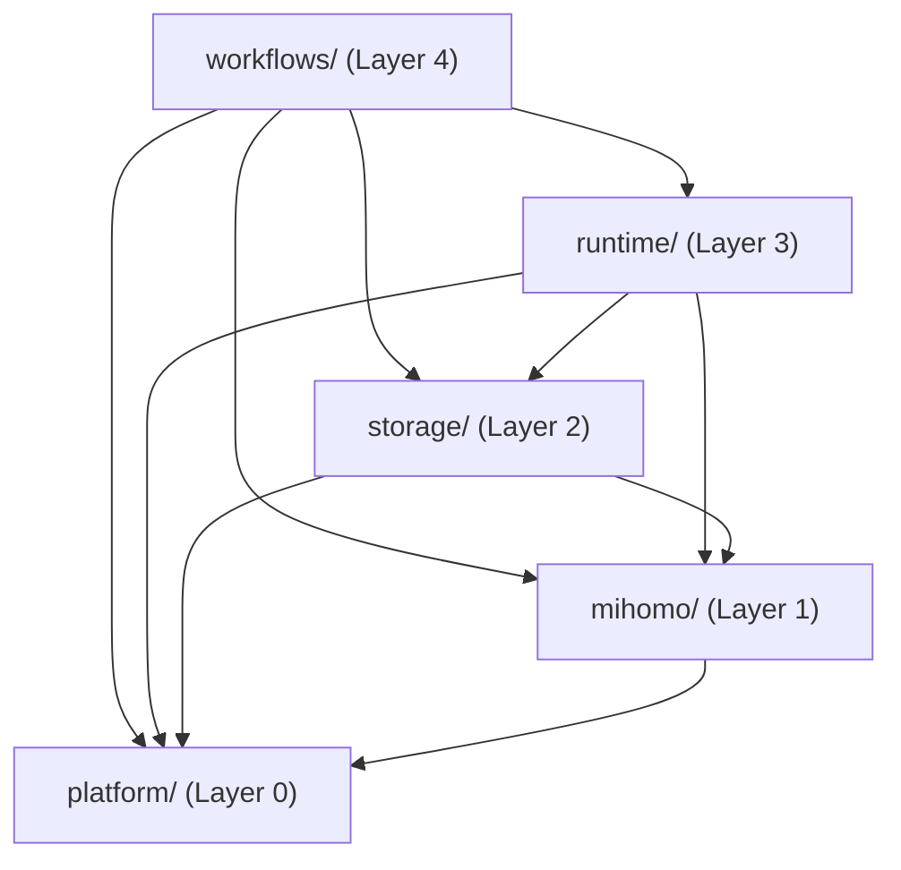

# `crates/zenclash-core` 代码与测试组织重新设计方案

- **文档日期**：2026-11-22
- **适用范围**：`crates/zenclash-core`（源码物理组织、白盒单元测试、黑盒集成测试、测试夹具与 CI 静态分层门禁）
- **关联文档**：[architecture-review-2026-11-21.md](architecture-review-2026-11-21.md)、[software-design-v2-2026-11-21.md](software-design-v2-2026-11-21.md)

---

## 一、现状诊断（为什么看起来仍然混乱）

尽管此前已完成逻辑去环与 `lib.rs` 门面导出，但物理文件布局与测试组织仍存在 5 个核心痛点：

1. **物理目录仍为 70+ 项顶层大平铺**：打开 `crates/zenclash-core/src/` 会同时看到 5 个层次的 70+ 个 `.rs`/目录，`lib.rs` 的五层门面与物理文件系统脱节，新开发者无法通过目录结构判断模块层级与依赖方向。
2. **模块风格与领域归属割裂**：
   - `foo/mod.rs`（`backup/`、`core_update/`、`service/`、`traffic_history/`）与 `foo.rs + foo/`（其余 20+ 模块）混用。
   - 同一概念被拆碎：4 个顶层 `tun_*.rs`（`tun_admission.rs`、`tun_config.rs`、`tun_permissions.rs`、`tun_runtime.rs`）；单复数并存 `profile.rs` 与 `profiles.rs`；4 个割裂的服务目录 `service/`、`service_manager/`、`service_runtime/`、`service_runtime_session/`；5 个去环拆出的胶水文件（`core_errors.rs`、`session_errors.rs`、`observation_types.rs`、`system_proxy_types.rs`、`stream_publication_test_support.rs`）裸露在顶层。
3. **超大生产文件与内联单测严重混编**：Top 12 文件合计超过 15,000 行，其中 45%–60% 为内联 `#[cfg(test)]`（如 `traffic_capture.rs` 2,681 行、`operational_status.rs` 1,979 行、`runtime_launcher.rs` 1,660 行、`logs.rs` 1,293 行、`service/runstate/mod.rs` 1,305 行）。
4. **测试辅助设施四处分散**：`src/test_support/`、`src/stream_publication_test_support.rs`、`src/core_session/test_support/`、`src/tun_runtime/test_support.rs`、`tests/support/mock_core.rs` 各自为政。
5. **集成测试（`tests/`）分层不清且链接开销大**：
   - `real_mihomo.rs` 单文件膨胀至 **1,498 行**。
   - `Cargo.toml` 声明不一致：`native_service_client`、`native_service_session` 声明了 `required-features = ["service-ipc-tests"]`，而同属该类的 `native_service_lifetime` 未声明。
   - 6 个顶层 `tests/*.rs` 各自编译为独立二进制（重复链接开销高），且**缺少面向五层公有 API 的快速黑盒集成测试套件**。

---

## 二、目标物理目录组织（`src/` 严格 5 层单向目录树）

### 2.1 顶层视图（70+ 平铺项 → 7 个清晰入口）

```text
crates/zenclash-core/
├── Cargo.toml
├── src/
│   ├── lib.rs                 # 极薄 crate 根：文档、lint、5 个物理层声明 + 精选顶层兼容重导出
│   ├── platform.rs + platform/      # Layer 0：纯 OS 原语与路径基础设施（0 内部层依赖）
│   ├── mihomo.rs + mihomo/          # Layer 1：协议、模型、无状态配置管线与 TUN 原语（仅依赖 platform）
│   ├── storage.rs + storage/        # Layer 2：持久化仓库与跨目录事务（仅依赖 platform, mihomo）
│   ├── runtime.rs + runtime/        # Layer 3：内核进程租约、启动器与唯一 CoreSession（仅依赖 L0–L2）
│   ├── workflows.rs + workflows/    # Layer 4：捕获、服务维护、代理操作、遥测与诊断（仅依赖 L0–L3）
│   └── test_support.rs + test_support/ # 统一测试夹具模块（#[cfg(any(test, feature = "test-support"))]）
└── tests/                     # 黑盒集成测试（按运行前提聚合为 3 个测试二进制）
    ├── core_integration/      # 默认 CI 必跑：纯黑盒公有 API 跨层集成测试（零外部二进制）
    ├── service_ipc/           # feature = "service-ipc-tests"：模拟特权服务 IPC 集成测试
    ├── real_core/             # #[ignore]：真实 mihomo 二进制端到端验收测试
    └── support/               # mock_core bin 与共享集成测试 harness
```

> **统一模块风格规范（Rust 2024）**：
> - 全仓统一采用 **无 `mod.rs` 风格**（`<name>.rs` + `<name>/`），消除编辑器多个同名 `mod.rs` 标签页问题，同时彻底清理现有 `backup/mod.rs`、`core_update/mod.rs`、`service/mod.rs`、`traffic_history/mod.rs`、`service/runstate/mod.rs` 的混用风格。

### 2.2 五层内部完整映射表

```text
src/
├── lib.rs
│
├── platform/                              # Layer 0（仅依赖 std & 外部基础 crate）
│   ├── paths/                             # 原 application_paths/（AppDataPaths / BundledResources / WorkspaceResources）
│   ├── command/                           # 原 platform_command/（有界非阻塞子进程执行）
│   ├── autostart/                         # 原 autostart/{macos,linux,windows,unsupported}.rs
│   ├── instance_lock.rs                   # 单实例进程锁
│   └── fs_io.rs                           # 抽离通用 atomic_write / sync_all / FIFO 防护 / 私有文件权限（原散落在 profiles/storage & logs/private_io）
│
├── mihomo/                                # Layer 1（仅依赖 platform）
│   ├── errors.rs                          # 原 core_errors.rs（MihomoError / VersionInfo / PacError / SystemProxyError）
│   ├── endpoint.rs                        # MihomoEndpoint
│   ├── models/                            # 原 models/（Connection / RuntimeConfig / Rule / Provider / Memory / DNS）
│   ├── proxy.rs                           # 原 proxy.rs（ProxyCatalog / ProxyGroup / ProxyNode / DelayHistory）
│   ├── http_body.rs                       # 唯一有界 HTTP 响应体读取器
│   ├── websocket.rs                       # 有界 WebSocket 传输配置与重连退避
│   ├── config/                            # 合并原 profile.rs + config_pipeline.rs + config_diff.rs + core_validation.rs + listener_fallback.rs
│   │   ├── merge.rs                       # 原 profile.rs（YAML 合并与 << 展开）
│   │   ├── pipeline.rs                    # 原 config_pipeline.rs（EffectiveConfigPipeline / OverrideKeys / HOT/FULL 键集）
│   │   ├── diff.rs                        # 原 config_diff.rs
│   │   ├── validation.rs                  # 原 core_validation.rs
│   │   └── listener_fallback.rs           # 原 listener_fallback.rs
│   ├── tun/                               # 合并原 4 个零散顶层 tun_*.rs
│   │   ├── config.rs                      # 原 tun_config.rs
│   │   ├── admission.rs                   # 原 tun_admission.rs
│   │   ├── permissions.rs                 # 原 tun_permissions.rs
│   │   └── runtime/                       # 原 tun_runtime/{macos,linux,windows}.rs
│   ├── system_proxy_types.rs              # 原 system_proxy_types.rs（纯值类型与校验规则，供 storage/preferences 与 workflows/capture 共用）
│   ├── ruleset.rs                         # 规则集格式转换
│   └── client/                            # 原 client/（api / connections / request / transport）
│
├── storage/                               # Layer 2（仅依赖 platform, mihomo）
│   ├── coordinator.rs                     # 原 data_coordinator.rs（DataWriteLease / DataWriteAccess）
│   ├── preferences/                       # 原 preferences/
│   ├── profiles/                          # 原 profiles/（CRUD / 索引 / 下载 / 调度 / 事务应用）
│   ├── overrides/                         # 原 yaml_overrides/
│   ├── controlled/                        # 原 controlled_config/
│   ├── traffic_history/                   # 原 traffic_history/（SQLite 长连接 + 查询 + 模型）
│   └── backup/                            # 原 backup/（ZIP 导出/导入 + WAL 事务恢复）
│
├── runtime/                               # Layer 3（仅依赖 platform, mihomo, storage）
│   ├── errors.rs                          # 原 session_errors.rs（CoreSessionError / TrafficCaptureError）
│   ├── backend.rs                         # 原 core_backend.rs（CoreKind / CoreCapabilities）
│   ├── launcher.rs                        # 原 runtime_launcher.rs（CoreProcessLauncher / CoreProcessLease / KernelOwner / LeftoverLease / IntentReconciler）
│   ├── owner.rs                           # 原 owned_core.rs（OwnedCore 桥接）
│   ├── local/                             # 本地托管内核全生命周期
│   │   ├── process/                       # 原 managed_core_process/
│   │   ├── installation.rs                # 原 core_installation.rs
│   │   └── update/                        # 原 core_update/
│   ├── service/                           # 提权服务会话与资源适配（收拢原 service/ + service_runtime/ + service_runtime_session/）
│   │   ├── ipc/                           # 原 service/{session,controller,health,maintenance,owner_identity,platform,runstate,runtime_bundle,running_mode,sidecar}.rs
│   │   ├── bundle/                        # 原 service_runtime/
│   │   └── session/                       # 原 service_runtime_session/
│   └── session/                           # 原 core_session/（唯一 CoreSession 状态机与事务准入）
│
├── workflows/                             # Layer 4（仅依赖 platform, mihomo, storage, runtime）
│   ├── capture/                           # 合并系统代理与流量捕获编排
│   │   ├── session.rs                     # 原 traffic_capture.rs（+ backend.rs / core_recovery.rs / error.rs）
│   │   └── system_proxy/                  # 原 system_proxy/{configuration,native,pac,summary,macos,linux,windows,unsupported}.rs
│   ├── service_manager/                   # 原 service_manager/
│   ├── operations/                        # 代理与 Provider 业务操作
│   │   ├── proxy/                         # 原 proxy_operations/
│   │   └── provider/                      # 原 provider_operations/
│   ├── telemetry/                         # 运行态观测与实时流
│   │   ├── observation.rs                 # 原 observation_types.rs
│   │   ├── traffic/                       # 原 traffic/
│   │   ├── logs/                          # 原 logs/
│   │   └── status/                        # 原 operational_status/
│   └── diagnostics/                       # 网络探测、诊断、AI 网络与版本更新
│       ├── network/                       # 原 network/
│       ├── runner/                        # 原 network_diagnostics/
│       ├── ai_network/                    # 原 ai_network/
│       └── app_update.rs                  # 原 app_update.rs
│
└── test_support/                          # 统一测试支撑（仅 test / test-support 特性编译）
    ├── http.rs                            # 原 test_support/http.rs
    ├── stream_publication.rs              # 原 stream_publication_test_support.rs
    ├── session.rs                         # 原 core_session/test_support/
    └── tun.rs                             # 原 tun_runtime/test_support.rs
```

---

## 三、单元测试组织规范（White-Box Unit Tests）

### 3.1 统一拆分规则
1. **体量门槛**：
   - `<= 80` 行的轻量纯函数测试：可留在生产文件末尾 `#[cfg(test)] mod tests { ... }`。
   - `> 80` 行的测试：**强制拆离为独立测试文件**，生产文件底部只保留 2 行：
     ```rust
     #[cfg(test)]
     mod tests;
     ```
   - 当某模块单测超过 `~600` 行时，进一步按主题拆为 `<module>/tests.rs` + `<module>/tests/<topic>.rs`（如 `tests/lifecycle.rs`、`tests/rollback.rs`、`tests/security.rs`）。
2. **明确职责边界**：
   - **单元测试（`src/**` 内）**：只测试内部不变量、私有状态机转换、边界解析、错误分类、锁/并发细粒度行为（需要访问 `pub(crate)` / 私有字段或内存 Mock）。
   - **严禁**：在单元测试里重复编写完整跨层端到端场景或重复造 Mock HTTP Server（一律复用 `crate::test_support::http` 等公共夹具）。

### 3.2 首批超大生产文件内联测试剥离清单

| 现有生产文件 | 当前行数 | 内联测试占比（约） | 拆离目标 |
| --- | ---: | ---: | --- |
| `traffic_capture.rs` | 2,681 | ~1,600 行（60%） | `workflows/capture/session/tests.rs` + `{plans,rollback,service_tun}.rs` |
| `operational_status.rs` | 1,979 | ~1,000 行（50%） | `workflows/telemetry/status/tests.rs` + `{refresh,first_run}.rs` |
| `runtime_launcher.rs` | 1,660 | ~550 行（33%） | `runtime/launcher/tests.rs` |
| `service/runstate/mod.rs` | 1,305 | ~750 行（57%） | `runtime/service/ipc/runstate/tests.rs` |
| `logs.rs` | 1,293 | ~650 行（50%） | `workflows/telemetry/logs/tests.rs` |
| `client/api.rs` | 1,177 | ~450 行（38%） | `mihomo/client/api/tests.rs` |
| `service/session.rs` | 1,173 | ~520 行（44%） | `runtime/service/ipc/session/tests.rs` |
| `system_proxy.rs` | 1,117 | ~400 行（36%） | `workflows/capture/system_proxy/tests.rs` |
| `proxy.rs` | 1,019 | ~380 行（37%） | `mihomo/proxy/tests.rs` |
| `service_manager.rs` & `maintenance.rs` | 999 / 996 | ~450 / ~460 行 | `workflows/service_manager/tests.rs` & `maintenance/tests.rs` |
| `managed_core_process.rs` | 991 | ~320 行（32%） | 合并进 `runtime/local/process/tests.rs` |
| `logs/file.rs` | 903 | ~420 行（47%） | `workflows/telemetry/logs/file/tests.rs` |

拆离后，生产源文件将普遍降至 **300–650 行**，浏览业务逻辑不再被上千行测试淹没。

---

## 四、集成测试重新设计（`crates/zenclash-core/tests/`）

### 4.1 按运行前提与测试等级划分为 3 个聚合测试二进制

遵循 Rust 社区最佳实践（将多个同特性 `tests/*.rs` 合并为 `tests/<suite>/main.rs`，避免为每个文件单独链接一个独立测试可执行文件）：

```text
crates/zenclash-core/tests/
├── core_integration/              # 【Tier 1】默认 CI 必跑（零外部进程/零特权依赖，秒级完成）
│   ├── main.rs                    # 仅通过 zenclash_core::* 公有 API 测试（纯黑盒）
│   ├── config_pipeline.rs         # EffectiveConfigPipeline + OverrideKeys + 端口回退 + Diff 端到端
│   ├── storage_transactions.rs    # Profile + Override + Controlled + Backup + TrafficHistory 跨仓事务
│   ├── runtime_reconciler.rs      # LocalLauncher + LeftoverLeaseTracker + IntentReconciler 完整生命周期
│   └── telemetry_and_pac.rs       # PacServer + LogMonitor + TrafficMonitor + OperationalStatus 跨模块联动
│
├── service_ipc/                   # 【Tier 2】required-features = ["service-ipc-tests"]（Mock IPC + mock_core）
│   ├── main.rs
│   ├── client.rs                  # 原 native_service_client.rs
│   ├── lifetime.rs                # 原 native_service_lifetime.rs（修复漏声明 required-features 问题！）
│   └── session.rs                 # 原 native_service_session.rs
│
├── real_core/                     # 【Tier 3】#[ignore]，本地/专项 CI 运行真实 mihomo 二进制
│   ├── main.rs
│   ├── harness.rs                 # 从 real_mihomo.rs 抽离公共真实内核启动/等待/清理夹具
│   ├── lifecycle.rs               # 拆分原 real_mihomo.rs（启动、停止、重载、崩溃恢复）
│   ├── config_and_overrides.rs    # 拆分原 real_mihomo.rs（订阅、覆写链、受控设置）
│   ├── proxies_and_rules.rs       # 拆分原 real_mihomo.rs（代理组切换、测速、规则、连接）
│   ├── automatic.rs               # 原 real_automatic.rs
│   └── local_recovery.rs          # 原 real_local_recovery.rs
│
└── support/
    └── mock_core.rs               # bin: zenclash-core-integration-test-core (required-features = ["service-ipc-tests"])
```

### 4.2 `Cargo.toml` 显式目标声明

```toml
[[bin]]
name = "zenclash-core-integration-test-core"
path = "tests/support/mock_core.rs"
required-features = ["service-ipc-tests"]

[[test]]
name = "core_integration"
path = "tests/core_integration/main.rs"

[[test]]
name = "service_ipc"
path = "tests/service_ipc/main.rs"
required-features = ["service-ipc-tests"]

[[test]]
name = "real_core"
path = "tests/real_core/main.rs"
```

收益：
- 开发者可按需精准运行：`cargo test -p zenclash-core --test core_integration`（秒级）、`--test service_ipc --features service-ipc-tests`、`--test real_core -- --ignored`。
- 消除 6 个独立集成测试二进制的重复链接，加快全仓编译与测试速度。
- 修复 `native_service_lifetime` 此前在默认特性下漏声明 `required-features` 的问题。

---

## 五、CI 静态分层守护升级（防结构再次腐化）

升级 `crates/zenclash-app/tests/architecture_guards.rs`，在保留“0 双向环”基础上，新增 **`zenclash_core_enforces_strict_five_layer_dag`** 静态守护测试：



- 校验 `crates/zenclash-core/src/` 顶层仅允许存在 `lib.rs`、`platform`、`mihomo`、`storage`、`runtime`、`workflows`、`test_support`（禁止再往顶层随意平铺新文件）。
- 校验任意非测试文件只能向下引用更低层（严格单向 DAG，任何 `platform -> mihomo`、`mihomo -> storage`、`storage -> runtime`、`runtime -> workflows` 均直接 CI 报错）。

---

## 六、零破坏实施路线（分 3 波次多 Agent 执行）

1. **Wave 1：物理五层目录迁移（零业务逻辑改动，100% 保留 `lib.rs` 对外导出）**
   - 将现有 70+ 顶层项通过 `git mv` 移入 `platform/`、`mihomo/`、`storage/`、`runtime/`、`workflows/` 与 `test_support/`，统一去掉 `mod.rs` 混用，同步更新内部 `crate::` 路径；`zenclash-app` 与 `zenclash-ui` 零改动直接通过编译。
2. **Wave 2：剥离 Top 12 超大生产文件内联测试 + 收口 `test_support/`**
   - 仅做纯机械测试抽离（不改动任何测试逻辑与断言），将 12 个 900–2,681 行的巨型文件拆分为干净的生产文件 + 独立 `tests.rs` / `tests/*.rs`。
3. **Wave 3：重组 `tests/` 三档集成测试 + 升级 CI 五层 DAG 守护**
   - 落地 `tests/core_integration/`、`tests/service_ipc/`、`tests/real_core/`（拆分 1,498 行 `real_mihomo.rs`）、更新 `Cargo.toml` 与 `architecture_guards.rs` 五层 DAG 门禁，全仓 `fmt` / 严格 `clippy` / `test` / `doc` 验收提交。
