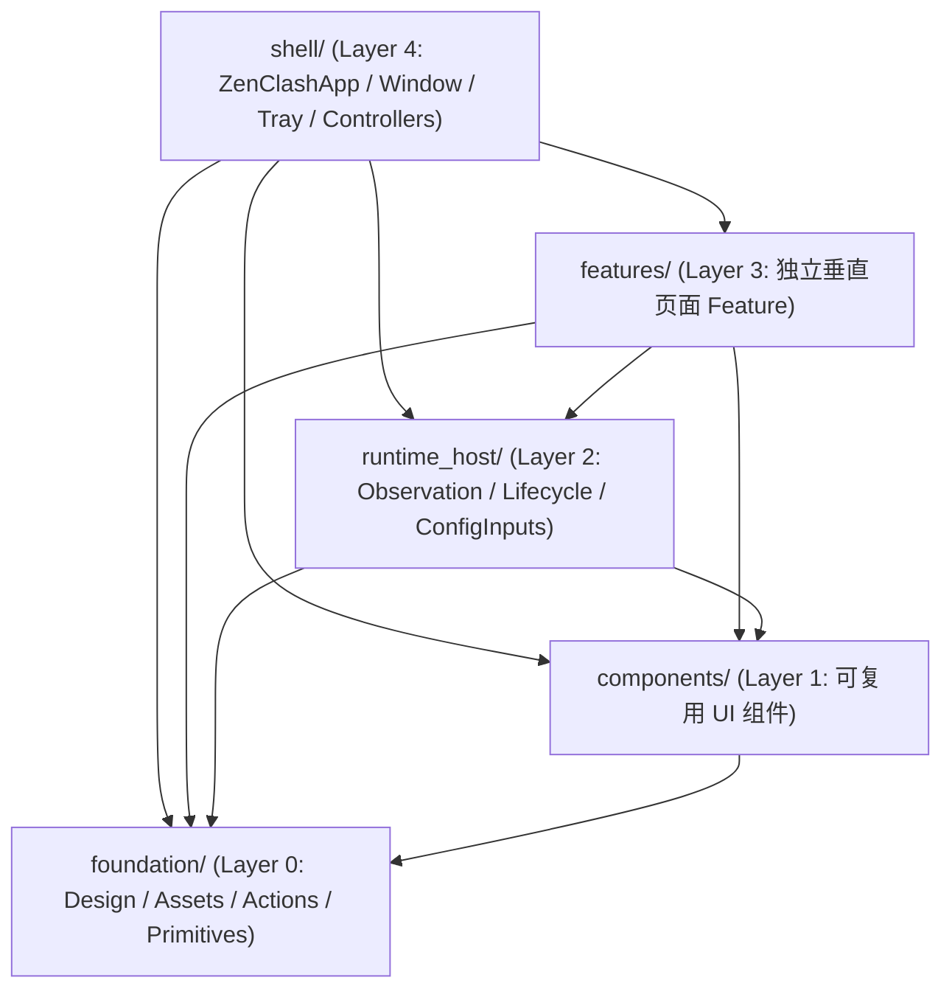

# `crates/zenclash-ui` 代码与测试组织重新设计方案

- **文档日期**：2026-11-22
- **适用范围**：`crates/zenclash-ui`（源码物理分层、状态所有权演进、白盒单元测试、GPUI 无头 UI 集成测试、统一测试夹具与 CI 静态守护）
- **关联文档**：
  - [architecture-review-2026-11-21.md](architecture-review-2026-11-21.md)
  - [software-design-v2-2026-11-21.md](software-design-v2-2026-11-21.md)
  - [zenclash-core-layout-redesign-2026-11-22.md](zenclash-core-layout-redesign-2026-11-22.md)
- **规范基准**：全仓统一 Rust 2024 无 `mod.rs` 风格（`<name>.rs` + `<name>/`）与 GPUI Kit Coding Guides（按能力边界垂直组织、依赖严格向下、纯逻辑单测与无头窗口 UI 集成测试分层）。

---

## 一、现状诊断（基于代码盘点的 6 大结构痛点）

当前 `crates/zenclash-ui/src/` 共 **214 个 `.rs` 文件**（生产文件 155 个、测试文件 59 个，总计约 6.3 万行，含 **508 个测试**：`#[test]` 231、`#[tokio::test]` 49、`#[gpui_kit::test]` 228），核心混乱来自以下 6 个方面：

1. **`pages/runtime/` 成为“巨型上帝宿主”（God-Host Sprawl）**
   - `pages/` 独占全 crate **85% 代码量**（163 个文件 / 54,001 行），其中 `pages/runtime/` 顶层直接平铺 **45 个项**，且有多达 **50 个生产文件分散编写 `impl RuntimePage`**。
   - **页面模型严重不对称**：全应用 15 个页面中，只有 `ProxiesPage` 是顶层 `pages/proxies/` 下的独立 `Entity<ProxiesPage>`；`ConnectionsView`、`LogsView`、`RulesView` 虽已是独立 `Entity` 却被埋在 `pages/runtime/` 下再经 `page_integration.rs` 桥接；其余 11 个页面直接写成 `impl RuntimePage` 方法，与宿主共享 30+ 字段。
   - 跨页基础设施（`busy.rs`、`common.rs`、`config_inputs.rs`、`feedback.rs`、`lifecycle.rs`、`page_observation.rs`、`page_task.rs`、`view.rs`）与业务页面（`home`、`profiles`、`network`、`settings`、`tun` 等）全部平铺在同一层，无法区分“框架壳”与“具体页面”。

2. **顶层散落胶水模块、同名双托盘目录与空目录残留**
   - `src/` 顶层裸露 3 个 25–183 行的内部胶水模块（`preference_previews.rs` 33L、`runtime_read_source.rs` 25L、`proxy_selection.rs` 183L），以及仅服务于 `main.rs` 的 `startup_failure.rs`（277L）。
   - 托盘代码分裂在两个同名目录：`src/tray/`（5 个文件，纯 OS 托盘图标/菜单驱动）与 `src/app/tray/`（11 个文件，托盘命令/刷新/观测协调），极易混淆职责。
   - 残留废弃空目录 `src/app/controllers/wifi/`。

3. **巨型单文件与内联测试严重混编**
   - Top 10 生产文件普遍在 **800–2,483 行**，其中 `pages/runtime/home.rs` 高达 **2,483 行**、`lifecycle.rs` **1,545 行**、`config_inputs.rs` **1,275 行**、`proxies/view.rs` **1,263 行**、`network.rs` **1,185 行**、`connections/dashboard.rs` **1,176 行**、`rules/dashboard.rs` **1,095 行**、`profiles/view/catalog.rs` **1,055 行**。
   - 共有 **21 个生产文件**内联了超过 80 行的 `#[cfg(test)] mod tests { ... }`（合计超过 **4,200 行**，部分文件内联测试占比达 50%–60%）。

4. **缺失 `tests/` 目录，508 个测试全部压在 `--lib` 单一测试目标内**
   - `crates/zenclash-ui/tests/` 目前**完全不存在**。
   - 228 个重型 `#[gpui_kit::test]` 无头窗口 UI 集成测试（分布在 61 个文件、超过 1.5 万行代码）与 280 个轻量单元测试全部编译链接进 `zenclash-ui --lib`，导致修改任意一行颜色常量或纯函数都会触发全量无头窗口测试重编。
   - 测试文件命名极其杂乱，同时存在 6 种风格：`tests.rs`、`ui_tests.rs`、`host_ui_tests.rs`、`observation_tests.rs`、`keyboard_tests.rs`、`page_integration/tests.rs`。

5. **测试夹具（Test Support）分散在 5 处且向生产类型渗透**
   - `app/test_support.rs`（31L）、`app/tray/test_support.rs`（158L）、`pages/proxies/test_support.rs`（316L）、`pages/runtime/test_support/`（4 文件 683L）、`pages/runtime/resources/test_support.rs`（131L）各自为政，合计 **1,319 行**。
   - 生产状态中存在测试侵入字段（如 `HomeUiState::design_validation`），导致难以编写纯粹的外部黑盒 UI 集成测试。

6. **CI 静态守护尚未覆盖 `zenclash-ui` 完整分层与 Feature 水平隔离**
   - 现有 `architecture_guards.rs` 仅守护了 `components`/`actions` 不依赖 `pages`/`app` 以及顶层无双向环，尚未约束 `zenclash-ui` 完整 5 层 DAG、Feature 间水平隔离以及禁止空目录残留。

---

## 二、目标物理目录架构（`src/` 严格 5 层单向目录树）

对齐 `zenclash-core` 的 5 层严格单向 DAG 设计与 GPUI Kit Coding Guides（*Organize large applications by capability*），将 `crates/zenclash-ui/src/` 收敛为 **5 个物理业务层 + 1 个统一测试夹具层 + 2 个 crate 入口文件**，全仓严格遵循 **Rust 2024 无 `mod.rs` 风格**（`<name>.rs` + `<name>/`）。

### 2.1 顶层视图（16+ 散落项 → 8 个清晰顶层入口）

```text
crates/zenclash-ui/
├── Cargo.toml
├── build.rs
├── build_version.rs
├── src/
│   ├── main.rs                           # 极薄二进制入口（Tracing、SafeMode、Tokio + Bootstrap + GPUI run）
│   ├── lib.rs                            # 极薄 crate 根：5 层物理声明 + 兼容重导出
│   ├── foundation.rs + foundation/       # Layer 0：主题令牌、内嵌资产、全局 Action、路由与共享状态原语（0 内部层依赖）
│   ├── components.rs + components/       # Layer 1：纯可复用 GPUI 组件与通用页面构建原语（仅依赖 foundation）
│   ├── runtime_host.rs + runtime_host/   # Layer 2：页面运行时宿主基础设施（仅依赖 foundation, components）
│   ├── features.rs + features/           # Layer 3：按业务能力垂直切分的独立页面 Feature（仅依赖 L0–L2；Feature 间水平隔离！）
│   ├── shell.rs + shell/                 # Layer 4：应用外壳 ZenClashApp、窗口生命周期、后台协调器与原生托盘（仅依赖 L0–L3）
│   └── test_support.rs + test_support/   # 统一 UI 测试夹具（#[cfg(any(test, feature = "test-support"))]）
└── tests/                                # 黑盒 UI 集成测试（按依赖深度聚合为 3 个独立测试二进制）
    ├── ui_components/                    # 【Tier 1】默认特征即可跑：纯组件与主题无头交互测试（毫秒级，零 Core/Tokio）
    ├── ui_features/                      # 【Tier 2】feature = "test-support"：单页面 Feature 无头 UI 集成测试
    └── ui_shell/                         # 【Tier 3】feature = "test-support"：整壳跨页端到端流测试（App + Tray + Service TUN）
```

### 2.2 五层内部完整映射表

```text
src/
├── main.rs                               # 原 main.rs（调用 shell::platform::startup_failure）
├── lib.rs                                # 声明 5 层 + test_support；保留必要 pub use 兼容导出（actions/app/assets/components/design/pages/tray）
│
├── foundation/                           # Layer 0（仅依赖 gpui-kit / zenclash-core / zenclash-app / zenclash-i18n）
│   ├── design.rs                         # 原 design.rs（ZenClash 语义色板、Surface 令牌、WCAG AA 对比度与主题切换）
│   ├── assets.rs                         # 原 assets.rs（内嵌 SVG 与品牌图标资源）
│   ├── actions.rs                        # 原 actions.rs（全局 GPUI actions!、Page 枚举与导航元数据）
│   └── primitives/                       # 收拢原顶层 3 个胶水文件
│       ├── preference_previews.rs        # 原 preference_previews.rs（菜单偏好未决预览值对象）
│       ├── runtime_read_source.rs        # 原 runtime_read_source.rs（CoreSession 读观测身份锚定）
│       └── proxy_selection.rs            # 原 proxy_selection.rs（Home 与 Proxies 共享的代理选择状态机）
│
├── components/                           # Layer 1（仅依赖 foundation；严禁依赖 runtime_host / features / shell）
│   ├── surface.rs                        # 统一表面原语（Card / Section / Banner / Inset）
│   ├── sidebar.rs                        # 全局可折叠导航侧栏
│   ├── feedback.rs                       # FeedbackNotifications（通知去重与语义等级）
│   ├── mint_switch.rs                    # 主题切换开关控件
│   ├── wave_percentage.rs                # 订阅用量波浪百分比指示器
│   ├── workspace.rs                      # 通用页面工作区骨架
│   └── page_primitives.rs                # 抽离自原 pages/runtime/common.rs（setting_card / info_row / metric / empty_state / list_page / format_*）
│
├── runtime_host/                         # Layer 2（仅依赖 foundation, components）
│   ├── services.rs                       # 原 RuntimePageServices + RuntimeMonitors + ShellPresentationState 契约定义
│   ├── observation.rs + observation/     # 原 pages/runtime/page_observation/（统一页级快照拉取、generation 防陈旧与取消）
│   ├── task_token.rs                     # 原 pages/runtime/page_task.rs（页面异步任务代际令牌）
│   ├── busy.rs                           # 原 pages/runtime/busy.rs（变更互斥与忙碌状态机）
│   ├── feedback.rs                       # 原 pages/runtime/feedback.rs（错误/成功横幅与 Toast 协调）
│   ├── config_inputs.rs + config_inputs/ # 原 pages/runtime/config_inputs/（拆分 1,275L 为 state.rs / sync.rs / validation.rs / host.rs）
│   └── lifecycle.rs + lifecycle/         # 原 pages/runtime/lifecycle/（拆分 1,545L 为 visibility.rs / schedule.rs / live_loop.rs / subscriptions.rs）
│
├── features/                             # Layer 3（仅依赖 L0–L2；同层 Feature 严禁互相引用内部实现！）
│   ├── host.rs + host/                   # 薄页面宿主 RuntimePage（原 pages/runtime.rs + view.rs，仅负责路由分发与共享状态挂载）
│   ├── home.rs + home/                   # 仪表盘首页（拆分 2,483L home.rs 为 state / transitions / cards / dashboard / selector / traffic / proxy_selection）
│   ├── proxies.rs + proxies/             # 原 pages/proxies/（独立 Entity<ProxiesPage>，拆分 1,263L view.rs 为 header / group_list / detail）
│   ├── profiles.rs + profiles/           # 原 pages/runtime/profiles/（拆分 1,055L view/catalog.rs 为 cards / actions_menu / empty）
│   ├── overrides.rs + overrides/         # 原 pages/runtime/overrides/
│   ├── connections.rs + connections/     # 原 pages/runtime/connections/（独立 Entity<ConnectionsView>，拆分 1,176L dashboard.rs）
│   ├── rules.rs + rules/                 # 原 pages/runtime/rules/（独立 Entity<RulesView>，拆分 1,095L dashboard.rs）
│   ├── traffic.rs + traffic/             # 原 pages/runtime/traffic/
│   ├── logs.rs + logs/                   # 原 pages/runtime/logs/（独立 Entity<LogsView>）
│   ├── network.rs + network/             # 原 pages/runtime/network/（拆分 1,185L network.rs 为 probes / diagnostics / ai / dialogs）
│   ├── resources.rs + resources/         # 原 pages/runtime/resources/（规则集、GeoData 与 Provider 操作）
│   ├── capture.rs + capture/             # 归口原 system_proxy/ + tun/（系统代理与 TUN 两大捕获路径同域管理）
│   │   ├── system_proxy.rs + system_proxy/
│   │   └── tun.rs + tun/
│   ├── kernel.rs + kernel/               # 归口原 mihomo/ + dns.rs + sniffer.rs（内核运行态、DNS、嗅探器配置同域管理）
│   │   ├── mihomo.rs + mihomo/
│   │   ├── dns.rs
│   │   └── sniffer.rs
│   └── settings.rs + settings/           # 原 pages/runtime/settings/ + preferences.rs（偏好设置、内核管理、备份恢复、更新与法务）
│
├── shell/                                # Layer 4（仅依赖 L0–L3；应用外壳组装层，严禁写具体页面业务逻辑）
│   ├── app.rs                            # 原 app.rs（ZenClashApp 根实体：仅组合窗口、Sidebar、Feature 与 Tray）
│   ├── bootstrap.rs                      # 原 app/bootstrap.rs（init / create_main_window_* / reopen_main_window）
│   ├── view.rs                           # 原 app/view.rs（主窗口 Chrome、标题栏、Sidebar 与内容区装配）
│   ├── window.rs                         # 原 app/window.rs（窗口尺寸、隐藏托盘、关闭拦截）
│   ├── actions.rs                        # 原 app/actions.rs（全局快捷键与 Action 分发）
│   ├── navigation.rs                     # 原 app/navigation.rs（页面切换协调）
│   ├── controllers/                      # 应用级后台协调器（彻底删除废弃空目录 wifi/）
│   │   ├── automatic.rs                  # 原 app/automatic.rs
│   │   ├── outbound_mode.rs              # 原 app/outbound_mode.rs
│   │   ├── preferences.rs                # 原 app/preferences.rs
│   │   ├── menu_preferences.rs           # 原 app/menu_preferences.rs
│   │   ├── profile_updates.rs            # 原 app/profile_updates.rs
│   │   └── system_proxy.rs               # 原 app/system_proxy.rs
│   ├── tray.rs + tray/                   # 统一收拢原顶层 src/tray/ 与 src/app/tray/！
│   │   ├── native.rs + native/           # 原 src/tray/{icon,menu,command_bindings,macos}.rs（纯 OS 托盘驱动）
│   │   ├── controller.rs                 # 原 app/tray.rs + app/tray/queue.rs
│   │   ├── commands.rs                   # 原 app/tray/commands.rs + proxy_commands.rs + directories.rs
│   │   └── refresh.rs                    # 原 app/tray/refresh.rs + runtime_observation.rs
│   └── platform.rs + platform/           # 原 app/platform.rs（打开目录等）+ startup_failure.rs（启动失败原生弹窗）
│
└── test_support/                         # 统一测试夹具（#[cfg(any(test, feature = "test-support"))]）
    ├── controller.rs                     # 原 pages/runtime/test_support/controller_fixture.rs（Mock Mihomo Controller）
    ├── owned_cores.rs                    # 原 pages/runtime/test_support/owned_cores.rs
    ├── runtime_host.rs                   # 原 pages/runtime/test_support/runtime_page_fixture.rs
    ├── service_workflow.rs               # 原 pages/runtime/test_support/service_workflow.rs
    ├── proxies.rs                        # 原 pages/proxies/test_support.rs
    ├── resources.rs                      # 原 pages/runtime/resources/test_support.rs
    └── shell_tray.rs                     # 原 app/test_support.rs + app/tray/test_support.rs
```

### 2.3 渐进式消除 `RuntimePage` 上帝对象（两阶段策略）

直接一次性重写 50 个 `impl RuntimePage` 文件风险过高；采用安全可控的两阶段演进：
1. **阶段 A（目录归口与大文件拆分）**：保持 `RuntimePage` 作为 `features/host.rs` 中的兼容宿主，先将所有页面物理迁移至 `features/<feature>/`，把 `home.rs`（2,483L）、`lifecycle.rs`（1,545L）、`config_inputs.rs`（1,275L）、`proxies/view.rs`（1,263L）、`network.rs`（1,185L）、`connections/dashboard.rs`（1,176L）、`rules/dashboard.rs`（1,095L）、`profiles/view/catalog.rs`（1,055L）拆分为 300–550 行职责单一的子模块，并用强类型 `RuntimeHostContext` 封装宿主共享服务。
2. **阶段 B（独立 `Entity<FeatureView>` 化）**：参照已成熟的 `ProxiesPage`、`ConnectionsView`、`LogsView`、`RulesView` 模式，优先将最重的 4 个页面逐个提升为独立 GPUI `Entity`：
   - `HomeView`（独立订阅 `TrafficMonitor` 与 `OperationalStatus`，避免首页动画重绘波及全局 `RuntimePage`）
   - `ProfilesView`（独立持有 `ProfileLibrary` 与表单 `InputState`，通过 `EventEmitter<ProfileEvent>` 向外壳发事件）
   - `NetworkView`（独立持有探测/诊断/AI 网络状态与对话框）
   - `SettingsView`（独立持有受控配置表单、核心管理、备份与偏好状态）
   - 最终 `RuntimePage` 退化为纯薄路由容器（仅持有共享服务句柄 + 各独立 `Entity` 页面）。

---

## 三、单元测试组织规范（White-Box Unit Tests）

严格遵循 GPUI Kit Testing Guide 的分层原则：**“纯逻辑用普通 `#[test]` / `#[tokio::test]`，需要实体/无头窗口交互的归入 UI 集成测试”**。

### 3.1 统一拆分与归类规则
1. **体量门槛**：
   - `<= 80` 行纯函数单元测试：允许保留在生产文件底部 `#[cfg(test)] mod tests { ... }`。
   - `> 80` 行单元测试：**强制拆离为独立同级文件** `tests.rs`（生产文件末尾仅保留 `#[cfg(test)] mod tests;`），严禁使用 `mod.rs`。
   - 单模块测试超过 `~500` 行时，按主题进一步拆为 `<module>/tests.rs` + `<module>/tests/<topic>.rs`。
2. **命名统一**：
   - 彻底消除当前 6 种混乱命名（`tests.rs`、`ui_tests.rs`、`host_ui_tests.rs`、`observation_tests.rs`、`keyboard_tests.rs`、`page_integration/tests.rs`）：
     - `src/**` 内只允许存在**白盒单元测试**，统一命名为 `tests.rs` 或 `tests/<topic>.rs`（如 `tests/keyboard.rs`、`tests/observation.rs`、`tests/projection.rs`）。
     - 所有基于 `#[gpui_kit::test]` + `TestWindowExt` 驱动真实视图与点击/键入的 **UI 集成测试**，统一迁出至 `crates/zenclash-ui/tests/`！
3. **测试边界红线**：
   - `src/**` 白盒单元测试原则上只使用 `#[test]` / `#[tokio::test]`（以及极少数必须访问私有状态的纯 `TestAppContext` 状态机单元测试，**不创建完整无头窗口**）。
   - 禁止在单元测试模块中使用 `use gpui_kit::*;`（避免 GPUI 的 `test` 宏遮蔽标准库 `#[test]`，遵循 `gpui-kit/references/gpui/test.md`）。

### 3.2 首批超大生产文件内联测试剥离清单（共 16 个核心目标）

| 现有生产文件 | 当前行数 | 内联测试行数（占比） | 拆离目标 |
| --- | ---: | ---: | --- |
| `pages/runtime/home.rs` | 2,483 | 648 行（26%） | `features/home/tests.rs` + 拆分生产代码为 `state`/`transitions`/`cards` |
| `pages/runtime/home/selector.rs` | 911 | 300 行（32%） | `features/home/selector/tests.rs` |
| `app/view.rs` | 795 | 299 行（37%） | `shell/view/tests.rs` |
| `pages/runtime/config_inputs.rs` | 1,275 | 245 行（19%） | `runtime_host/config_inputs/tests.rs` |
| `pages/runtime/rules/projection.rs` | 378 | 227 行（60%） | `features/rules/projection/tests.rs` |
| `pages/runtime/connections.rs` | 870 | 201 行（23%） | `features/connections/tests.rs` |
| `components/sidebar.rs` | 537 | 198 行（36%） | 逻辑单测 -> `components/sidebar/tests.rs`；无头交互 -> `tests/ui_components/` |
| `pages/runtime/home/traffic.rs` | 362 | 174 行（48%） | `features/home/traffic/tests.rs` |
| `pages/proxies/actions.rs` | 633 | 169 行（26%） | `features/proxies/actions/tests.rs` |
| `pages/runtime/network/model.rs` | 330 | 162 行（49%） | `features/network/model/tests.rs` |
| `app/system_proxy.rs` | 302 | 159 行（52%） | `shell/controllers/system_proxy/tests.rs` |
| `startup_failure.rs` | 277 | 150 行（54%） | `shell/platform/startup_failure/tests.rs` |
| `design.rs` | 424 | 147 行（34%） | `foundation/design/tests.rs` |
| `pages/runtime/lifecycle.rs` | 1,545 | 136 行（8%） | `runtime_host/lifecycle/tests.rs` |
| `pages/runtime/connections/timeline.rs` | 252 | 133 行（52%） | `features/connections/timeline/tests.rs` |
| `pages/runtime/profiles/state.rs` | 484 | 131 行（27%） | `features/profiles/state/tests.rs` |

> 同步处理其余 5 个 >80 行内联测试文件（`traffic/view.rs` 120L、`connections/projection.rs` 106L、`components/wave_percentage.rs` 103L、`settings/forms.rs` 91L、`tray.rs` 87L），实现全 crate 生产文件内联测试均 <= 80 行。

---

## 四、UI 集成测试重新设计（`crates/zenclash-ui/tests/`）

当前 228 个 `#[gpui_kit::test]` 全部混在 `--lib` 内部导致编译慢、边界不清。重新设计为 **3 个职责分明的聚合集成测试二进制**，与 GPUI Kit 官方测试工作流完全对齐：

### 4.1 三档集成测试金字塔

```text
crates/zenclash-ui/tests/
├── ui_components/                         # 【Tier 1】默认特性即跑（零 Core/Tokio，秒级验证视觉控件与键盘可访问性）
│   ├── main.rs
│   ├── theme_and_surface.rs               # Light/Dark 主题切换、Surface 层次与设计令牌渲染
│   ├── sidebar_navigation.rs              # Sidebar 折叠展开、导航 Action 派发、模式切换按钮
│   └── controls.rs                        # MintSwitch / WavePercentage / FeedbackNotifications 无头交互
│
├── ui_features/                           # 【Tier 2】required-features = ["test-support"]（单页面完整无头窗口流）
│   ├── main.rs
│   ├── home.rs                            # 迁出原 home/ui_tests.rs（首页流量卡、捕获开关、快速代理切换）
│   ├── proxies.rs                         # 迁出原 proxies/tests.rs 中的无头窗口交互流（1,663L 按场景拆出黑盒交互）
│   ├── profiles.rs                        # 迁出原 profiles/ui_tests.rs（1,304L 拆为 catalog / import_edit / activation）
│   ├── overrides.rs                       # 迁出原 overrides/ui_tests.rs
│   ├── connections.rs                     # 迁出原 connections/ui_tests.rs + page_integration/tests.rs
│   ├── rules.rs                           # 迁出原 rules/tests.rs 无头窗口部分
│   ├── logs.rs                            # 迁出原 logs/host_ui_tests.rs + logs/tests.rs 无头窗口部分
│   ├── traffic.rs                         # 迁出原 traffic/view/keyboard_tests.rs 无头键盘聚焦与激活流
│   ├── network.rs                         # 迁出原 network/ui_tests.rs
│   ├── capture_and_kernel.rs              # 迁出原 system_proxy/ui_tests.rs + mihomo/ui_tests.rs + config_inputs/{ui_tests,host_ui_tests}.rs
│   └── settings_and_backup.rs             # 迁出原 settings/ui_tests.rs + settings/backup/ui_tests.rs
│
└── ui_shell/                              # 【Tier 3】required-features = ["test-support"]（整壳跨页端到端流）
    ├── main.rs
    ├── app_lifecycle_and_window.rs        # 迁出原 app/window/tests.rs + lifecycle/ui_tests.rs + offline_pages 流
    ├── tray_and_menu_preferences.rs       # 迁出原 app/menu_preferences/tests.rs + tray_receipts.rs + app/tray/refresh/observation_tests.rs
    ├── service_tun_and_maintenance.rs     # 迁出原 pages/runtime/ui_tests/{service_tun,service_maintenance}.rs
    └── design_validation.rs               # #[cfg(target_os = "windows")] 迁出原 ui_tests/design_validation/
```

### 4.2 `Cargo.toml` 特性门控与显式目标声明（关键 Cargo 细节）

> **注意 Cargo 编译机制**：外部 `tests/*.rs` 集成测试编译被测 crate 时**不会**开启 `#[cfg(test)]`。因此若 `tests/ui_features` 与 `tests/ui_shell` 需要复用 `zenclash_ui::test_support` 夹具，必须在 `crates/zenclash-ui/Cargo.toml` 中像 `zenclash-core` / `zenclash-app` 一样显式声明 `test-support` feature（生产构建绝不开启）：

```toml
[features]
# 仅用于 UI 集成测试与隔离夹具；生产打包严禁启用。
test-support = [
    "gpui-kit/test-support",
    "zenclash-app/test-support",
    "zenclash-core/test-support",
]

[[test]]
name = "ui_components"
path = "tests/ui_components/main.rs"

[[test]]
name = "ui_features"
path = "tests/ui_features/main.rs"
required-features = ["test-support"]

[[test]]
name = "ui_shell"
path = "tests/ui_shell/main.rs"
required-features = ["test-support"]
```

**收益**：
- **开发期精准快跑**：
  - 改组件/主题：`cargo test -p zenclash-ui --test ui_components`（秒级，零 Tokio/Core）
  - 改纯状态逻辑：`cargo test -p zenclash-ui --lib`（仅剩快速单元测试，不再链接 1.5 万行无头窗口测试）
  - 改单页交互：`cargo test -p zenclash-ui --features test-support --test ui_features -- profiles`
  - 改整壳/托盘/提权流：`cargo test -p zenclash-ui --features test-support --test ui_shell`
- **全仓 CI 无缝衔接**：现有 `cargo test --workspace --all-features --locked` 自动覆盖全部 3 档 UI 集成测试 + `--lib` 单元测试，零遗漏。
- **消除测试代码侵入生产结构体**：通过 `test_support` 提供的公开受控构造函数/观测句柄驱动真实视图，逐步清理生产结构中的 `#[cfg(test)]` 字段。

---

## 五、CI 静态分层守护升级（防结构再次腐化）

在 [crates/zenclash-app/tests/architecture_guards.rs](file:///Users/haiwen/gitrepo/ZenClash/crates/zenclash-app/tests/architecture_guards.rs) 中，在已有全仓无 `mod.rs` 门禁与 `zenclash-core` 五层 DAG 门禁基础上，新增 4 项 `zenclash-ui` 专属静态门禁：



1. **`zenclash_ui_top_level_layout_is_strictly_five_layers`**
   - 校验 `crates/zenclash-ui/src/` 顶层仅允许存在 `lib.rs`、`main.rs`、`foundation(.rs)`、`components(.rs)`、`runtime_host(.rs)`、`features(.rs)`、`shell(.rs)`、`test_support(.rs)`（禁止再往顶层平铺胶水文件）。
2. **`zenclash_ui_enforces_strict_five_layer_dag`**
   - 校验生产代码严格遵循 `shell[4] -> features[3] -> runtime_host[2] -> components[1] -> foundation[0]`（同时拦截显式层路径与 `lib.rs` 根重导出反向引用，禁止任何向上依赖）。
3. **`zenclash_ui_features_are_horizontally_isolated`**
   - 校验 `features/` 下任意业务 Feature（如 `home`、`proxies`、`profiles`、`connections`、`rules`、`logs`、`traffic`、`network`、`resources`、`capture`、`kernel`、`settings`）**严禁直接引用兄弟 Feature 的内部模块**；跨 Feature 联动必须通过 `foundation::actions`、`runtime_host` 或 `shell` 编排（仅 `features/host.rs` 路由宿主可聚合各 Feature）。
4. **`zenclash_ui_has_zero_empty_source_directories`**
   - 扫描 `crates/zenclash-ui/src/` 断言不存在任何空目录（防止类似 `src/app/controllers/wifi/` 的死目录残留）。

---

## 六、零破坏实施路线（分 4 波次多 Agent 执行）

1. **Wave 1：物理 5 层目录迁移 + 清理空目录与双托盘分裂（零业务逻辑改动）**
   - 删除空目录 `src/app/controllers/wifi/`；通过 `git mv` 将现有模块迁入 `foundation/`、`components/`、`runtime_host/`、`features/`、`shell/` 与统一 `test_support/`；统一收拢 `tray/` 与 `app/tray/` 到 `shell/tray/`；`lib.rs` 保持对外公开 API 兼容。
   - **验收**：全仓 `fmt` / 11 条严格 `clippy` / `cargo test --workspace --all-features --locked` / `cargo doc -D warnings` 全绿，测试总数精确持平（508）。

2. **Wave 2：超大生产文件拆分 + 剥离全部 21 个文件内联单元测试**
   - 并行拆离 21 个生产文件（>80 行内联测试）至同级 `tests.rs`，并同步将 `home.rs`（2,483L）、`lifecycle.rs`（1,545L）、`config_inputs.rs`（1,275L）、`proxies/view.rs`（1,263L）、`network.rs`（1,185L）、`connections/dashboard.rs`（1,176L）、`rules/dashboard.rs`（1,095L）、`profiles/view/catalog.rs`（1,055L）拆分为 300–550 行高内聚子模块。
   - **验收**：全仓 `fmt` / 严格 `clippy` / 全量测试数精确持平。

3. **Wave 3：落地 `tests/` 三档 UI 集成测试 + 收口 `test_support/`**
   - 在 `crates/zenclash-ui/Cargo.toml` 新增 `test-support` 特性与 3 个 `[[test]]` 目标（`ui_components`、`ui_features`、`ui_shell`）。
   - 将散落在 `src/` 的重型无头窗口 UI 集成测试（`*_ui_tests.rs`、`pages/runtime/ui_tests/*`、`components` 交互测试等）迁出至 `tests/ui_{components,features,shell}/`，并补齐 Tier 1 `ui_components` 零 Core 快测套件。
   - 升级 `crates/zenclash-app/tests/architecture_guards.rs` 新增 4 项 `zenclash-ui` 静态架构门禁。
   - **验收**：默认特性 `cargo test -p zenclash-ui --test ui_components` 秒级全过，`--all-features` 全仓 5 项 CI 门禁全绿。

4. **Wave 4（可选增量演进）：核心重型页面独立 `Entity` 化**
   - 在架构和 CI 门禁稳定后，按 `HomeView` → `ProfilesView` → `NetworkView` → `SettingsView` 顺序渐进将 `impl RuntimePage` 拆分为独立 GPUI `Entity`，最终使 `RuntimePage` 退化为纯薄路由容器。
